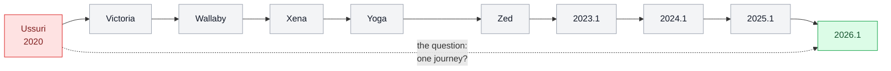
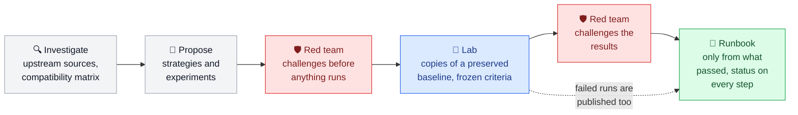
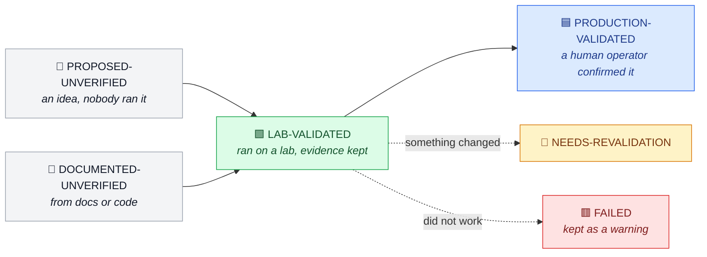
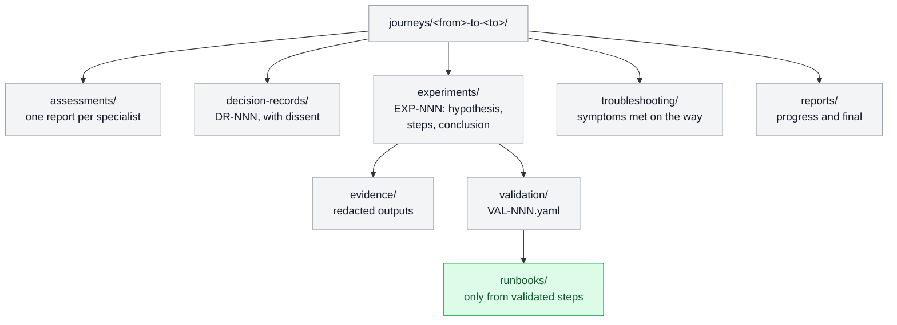

[← OzarLand home](https://github.com/OzarLand/ozarland)

# 🧭 openstack-upgrade-journeys

### Bringing legacy OpenStack clouds back to a modern release, safely and with evidence

**Many production clouds still run OpenStack releases that went out of maintenance years ago. This project builds
open, evidence-based paths to bring them back to a current release without losing a single VM, volume, network or
user. The first journey takes a Kolla-Ansible Ussuri cloud (2020) to OpenStack 2026.1.**

  
  
  
  
  
  
  

  <a href="#-the-gap"><b>The gap</b></a> ·
  <a href="#-how-a-journey-works"><b>Method</b></a> ·
  <a href="#-ussuri--20261-what-the-lab-showed"><b>Results</b></a> ·
  <a href="#️-journeys"><b>Journeys</b></a> ·
  <a href="docs/validation-status.md"><b>Validation rules</b></a> ·
  <a href="#-contributing"><b>Contribute</b></a>

---

Part of [OzarLand](https://github.com/OzarLand/ozarland): *a shared land for better OpenStack operations.*
Led by Soufian Zaouam.

## 🚀 The gap

Upstream upgrades one release at a time, or one SLURP step. From Ussuri that is nine upgrades and three host OS
changes before a maintained release, so many clouds stay where they are. This project looks for a safer, shorter way,
in the open, with evidence.

## 🔄 How a journey works

## 🔬 Ussuri → 2026.1: what the lab showed

The databases of every service reach 2026.1 **without deploying any intermediate release**: the migration code of a
few releases runs offline, on copies, with the services stopped. 2026.1 then starts on the result and operates every
pre-existing resource. Lab-verified on a container lab with synthetic data; **unsupported upstream; not for
production.**

```mermaid
flowchart LR
    subgraph stop["Control plane stopped, computes fenced"]
      U["Ussuri DBs<br/>MariaDB 10.3"] -->|"2023.1 code<br/>bridge to Alembic"| H1["2023.1"]
      H1 -->|"Cinder 23.5.0 only<br/>(use_quota fix)"| H1b["2023.2"]
      H1b -->|"2024.1 code"| H2["2024.1"] -->|"2025.1 code"| H3["2025.1"] -->|"2026.1 code"| H4["2026.1 DBs<br/>MariaDB 11.4"]
    end
    H4 --> S["2026.1 services<br/>fresh RabbitMQ 4"]
    S --> F["Every old resource<br/>read back and operated<br/>(servers, volumes,<br/>networks, users)"]
    N["❌ 2026.1 code<br/>directly on Ussuri"] -. "refused:<br/>no legacy path" .-> U
    classDef old fill:#fee2e2,stroke:#dc2626,color:#7f1d1d
    classDef mid fill:#fef3c7,stroke:#d97706,color:#78350f
    classDef ok fill:#dcfce7,stroke:#16a34a,color:#14532d
    classDef no fill:#f3f4f6,stroke:#9ca3af,color:#6b7280,stroke-dasharray: 4 4
    class U old
    class H1,H1b,H2,H3 mid
    class H4,S,F ok
    class N no
```

| Finding | Status |
|---|---|
| A direct jump is impossible: 2026.1 Nova, Keystone and Cinder cannot read a Ussuri database | Confirmed in the lab |
| Database fast-forward Ussuri → 2026.1 with no intermediate deployment, zero unexpected schema or data change | Lab-verified, synthetic data, unsupported upstream |
| 2026.1 services start on the result and operate old servers, volumes, networks and users | Lab-verified, synthetic data |
| A Cinder bug breaks the **official** 2023.1 → 2024.1 upgrade for clouds with old deleted volumes | [Documented](journeys/ussuri-to-2026.1/troubleshooting/cinder-use-quota-null-blocks-2024.1-db-sync.md) |
| Kolla-Ansible 2026.1 changes data when deployed on existing databases; ten mandatory steps identified | Lab-verified for the commands; Kolla itself not run |

Not yet done: rollback rehearsal, a real Kolla-Ansible lab with real VMs, a run on a production copy. Details:
[journey page](journeys/ussuri-to-2026.1/README.md) ·
[final report](journeys/ussuri-to-2026.1/reports/2026-10-31-final-report-session-1.md) ·
[draft runbook](journeys/ussuri-to-2026.1/runbooks/ussuri-to-2026.1-database-fast-forward-lab-runbook.md).

> [!WARNING]
> **Nothing here is a supported or production-validated procedure.** Never run a step on a platform whose data you
> cannot afford to lose without your own backups, your own rehearsal and your own change review.

## 🏷️ How claims are labelled

Every step and every result carries one of these statuses. Reading code or documentation never counts as validation.

Claims about what is *possible* use a second vocabulary: officially supported, technically possible but unsupported,
experimentally validated, not validated, incompatible. Rules and mapping to the other OzarLand repositories:
[`docs/validation-status.md`](docs/validation-status.md).

## 🗺️ Journeys

| Journey | Question | Stage |
|---|---|---|
| [Ussuri → 2026.1](journeys/ussuri-to-2026.1/README.md) | Can a Kolla-Ansible Ussuri cloud reach 2026.1 in one journey, and what is the safest path with the fewest intermediate deployments? | Lab experiments; draft runbook; nothing production-validated |

Another starting release or deployment method? Propose it in an
[*Ideas* discussion](https://github.com/OzarLand/ozarland/discussions/new?category=ideas).

## 🗂️ Inside a journey

Laboratory scripts live in [`lab/`](lab/), templates in [`docs/templates/`](docs/templates/).

## 🤝 Contributing

The most valuable contribution is **evidence**: you ran a step on a lab or a real platform and it worked, failed or
worked partly. Then: a wrong or unsafe step, or your own starting point for a next journey.

- [Report a run](https://github.com/OzarLand/openstack-upgrade-journeys/issues/new?template=experiment-report.yml) ·
  [Report a wrong or unsafe procedure](https://github.com/OzarLand/openstack-upgrade-journeys/issues/new?template=unsafe-or-wrong-procedure.yml) ·
  [CONTRIBUTING.md](CONTRIBUTING.md)
- Never publish credentials, real hostnames, database dumps or unredacted logs
  ([sensitive data](https://github.com/OzarLand/ozarland/blob/main/docs/conventions/sensitive-data.md)).

> [!NOTE]
> The investigation is carried out by a team of AI agents with separate roles (architect, compatibility,
> Kolla-Ansible, databases, laboratory, operations, documentation, and an independent red team), working from the
> upstream sources and the [OzarLand operator skills](https://github.com/OzarLand/openstack-operator-skills), under
> the direction of the OzarLand owner. No human operator has confirmed a result on a real platform yet; that is the
> contribution we are looking for.

## 🌍 Part of OzarLand

**OzarLand: a shared land for better OpenStack operations.** It started as a personal initiative by Soufian Zaouam
to share practical OpenStack operational knowledge, and it is meant to grow into a space where operators exchange
experience, document solutions and help each other run more reliable platforms. It is open to everyone: your
knowledge, questions and corrections are welcome.

| | Repository | What it holds |
|:-:|---|---|
| | [ozarland](https://github.com/OzarLand/ozarland) | Start here: newcomer path, community rules, [Discussions](https://github.com/OzarLand/ozarland/discussions) |
| 🔧 | [openstack-vm-runbooks](https://github.com/OzarLand/openstack-vm-runbooks) | Symptom-driven runbooks for instance problems |
| 🏗️ | [kolla-ansible-deployment-patterns](https://github.com/OzarLand/kolla-ansible-deployment-patterns) | Ways to deploy with Kolla-Ansible, compared |
| 🧪 | [openstack-quick-lab](https://github.com/OzarLand/openstack-quick-lab) | A disposable OpenStack lab to practise on |
| 🤖 | [openstack-operator-skills](https://github.com/OzarLand/openstack-operator-skills) | Claude skills that apply this knowledge |
| 🧭 | `openstack-upgrade-journeys` **(you are here)** | Investigations of hard upgrade paths, with their evidence |

<!-- The last row is proposed. Adding a repository to this block is an owner decision and must be applied to every
     OzarLand repository in the same round of pull requests (docs/conventions/readme-identity.md). -->

## ⚖️ License

[Apache-2.0](LICENSE). OzarLand is not affiliated with the OpenStack Foundation, the OpenInfra Foundation or any
vendor; OpenStack and Kolla-Ansible are the work of their upstream communities.
