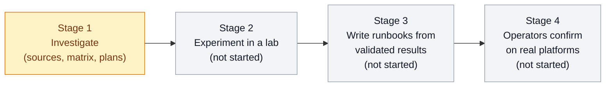

[← openstack-upgrade-journeys](../../README.md) · [← OzarLand home](https://github.com/OzarLand/ozarland)

# Journey: Kolla-Ansible Ussuri → OpenStack 2026.1

> Author: agent 8 (documentation and community engineer), Claude Sonnet 5.5, 2026-10-31. Status: **Stage 1,
> investigation. Nothing is validated.** Part of [OzarLand](https://github.com/OzarLand/ozarland): *a shared land for
> better OpenStack operations.*

> [!WARNING]
> **Nothing here is a supported procedure.** Upstream OpenStack and Kolla-Ansible do not document or test a direct
> upgrade from Ussuri to 2026.1. These pages are research notes written by AI agents from upstream source code and
> documentation. Reading is not validation. Do not run anything here on production, and not on any platform you cannot
> restore from a tested backup. Every step shows its validation status; if it says `UNVERIFIED`, nobody has run it.

## The question

Can an existing Kolla-Ansible **Ussuri** OpenStack deployment reach **OpenStack 2026.1** through a single upgrade
journey, without deploying and operating every intermediate release? If not, what is the safest practical path with
the fewest intermediate deployments? Data integrity and operational safety come before speed, and an unsupported
procedure is never presented as supported.

## Where we are

| | |
|---|---|
| **Stage** | 1: investigation (reading upstream sources, building the compatibility picture, designing lab experiments) |
| **Validated procedures** | 0 (`LAB-VALIDATED`: 0, `PRODUCTION-VALIDATED`: 0) |
| **Experiments run** | 0 |
| **Answer to the question** | Unknown. Not yet established by anything in this repository. |
| **Last updated** | 2026-10-31 |

The stage names are a working outline for orientation; the architect owns the plan.

## Map of documents

Documents are written by the agents of Stage 1. A link may not resolve until the architect commits the file.

| Document | What it holds |
|---|---|
| [`compatibility-matrix.md`](compatibility-matrix.md) | Release by release: what is supported, possible but unsupported, or incompatible, with sources |
| [`dependency-graph.md`](dependency-graph.md) | What must change before what: databases, message queue, host OS, container images, Ansible, Python |
| [`assessments/`](assessments/) | Specialist reports, one per topic. [`00-mission-brief.md`](assessments/00-mission-brief.md) is the shared brief; [`08-repository-organization.md`](assessments/08-repository-organization.md) explains this repository's structure and conventions. Other files are `assessments/0N-*.md`, named by their authors. |
| [`decision-records/`](decision-records/) | `DR-NNN`: each decision, its alternatives, evidence, risks and dissent ([template](../../docs/templates/decision-record.md)) |
| [`experiments/`](experiments/) | `EXP-NNN`: hypothesis, initial state, steps, evidence, conclusion ([template](../../docs/templates/experiment-record.md)) |
| [`validation/`](validation/) | `VAL-NNN.yaml`: the structured result of one execution ([template](../../docs/templates/validation-record.yaml)) |
| [`evidence/`](evidence/) | Redacted outputs that experiments and validations cite |
| [`runbooks/`](runbooks/) | Steps to follow. Only written from knowledge that has an honest status next to every step |
| [`rollback/`](rollback/) | What can be undone, from which point, and what cannot |
| [`troubleshooting/`](troubleshooting/) | Symptoms met along the journey, and what to check |
| [`lessons-learned.md`](lessons-learned.md) | What the work taught, including what failed |

How statuses are used: [validation status](../../docs/validation-status.md). How to contribute evidence:
[CONTRIBUTING](../../CONTRIBUTING.md).

## How to read a claim

Two labels appear next to claims. The **evidence class** says what is known about possibility: *Officially supported*,
*Technically possible but unsupported*, *Experimentally validated* (only if executed in this journey's lab, with
evidence), *Not validated*, *Incompatible*. The **validation status** says how well a procedure was tested:
`PROPOSED-UNVERIFIED`, `DOCUMENTED-UNVERIFIED`, `LAB-VALIDATED`, `PRODUCTION-VALIDATED`, `NEEDS-REVALIDATION`,
`FAILED`. Unknown values are written `unknown`; a missing value is never filled in with a plausible one.

## The agent team

Stage 1 is carried out by AI agents, each with one role, supervised by the architect. The owner of OzarLand takes
responsibility for the contributions under the Developer Certificate of Origin. No agent confirms its own work, and no
agent can make anything `PRODUCTION-VALIDATED`.

| Agent | Role | Writes | Model |
|---|---|---|---|
| Architect | Plans the journey, assigns the agents, merges their work, commits | The plan, the journey README, decisions with the owner | _to be filled by the architect_ |
| Agent 8 | Documentation and community engineer | Repository organisation, templates, root files, [assessment 08](assessments/08-repository-organization.md) | _to be filled by the architect_ |
| Agents 1 to 7 | Specialists; roles to be listed by the architect | `assessments/0N-*.md`, compatibility matrix, dependency graph | _to be filled by the architect_ |

## Environment limits of this mission

Stated so that nobody over-reads the results. The lab of this mission has no hardware virtualisation, 4 vCPU, 15 GB of
RAM and about 30 GB of disk, and no OpenStack cloud account. Several upstream sites and registries are not reachable
from it, so some evidence comes from upstream git repositories only. Details are in the
[mission brief](assessments/00-mission-brief.md).

## Open questions / what is not yet known

- Whether any path shorter than "every release" works for a real Ussuri deployment: unknown.
- Whether the Ussuri-era container images and packages can still be obtained by an operator today: to be verified,
  not assumed.
- Whether any path preserves running workloads and data: unknown until an experiment shows it.
- Which of these pages another team has run: none so far.
