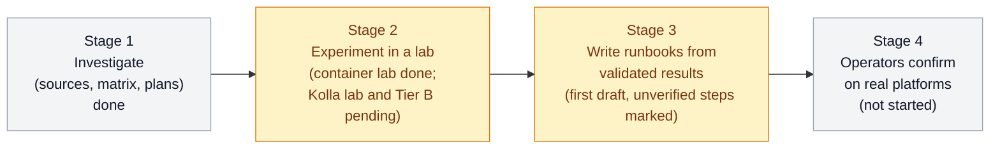

[← openstack-upgrade-journeys](../../README.md) · [← OzarLand home](https://github.com/OzarLand/ozarland)

# Journey: Kolla-Ansible Ussuri → OpenStack 2026.1

> Author: agent 8 (documentation and community engineer), Claude Sonnet 5.5, 2026-10-31. Updated by the architect on
> 2026-10-31. Status: **experiments under way. One database result is lab-validated in a narrow scope; no
> procedure is supported or production-validated.** Part of [OzarLand](https://github.com/OzarLand/ozarland): *a shared land for
> better OpenStack operations.*

> [!WARNING]
> **Nothing here is a supported procedure.** Upstream OpenStack and Kolla-Ansible do not document or test a direct
> upgrade from Ussuri to 2026.1. These pages are research notes written by AI agents from upstream source code and
> documentation. Reading is not validation. Do not run anything here on production, and not on any platform you cannot
> restore from a tested backup. Every step shows its validation status; if it says `UNVERIFIED`, nobody has run it.

## The question

Can an existing Kolla-Ansible **Ussuri** OpenStack deployment reach **OpenStack 2026.1** through a single upgrade
journey, without deploying and operating every intermediate release? If not, what is the safest practical path with
the fewest intermediate deployments? Data integrity and operational safety come before speed, and an unsupported
procedure is never presented as supported.

## Where we are

| | |
|---|---|
| **Stage** | 5 (independent review of the service-level results) and the first draft runbook; end of session 1 (see the [final report](reports/2026-10-31-final-report-session-1.md) and the [progress report](reports/2026-10-31-progress-report-01.md)) |
| **Validated procedures** | `LAB-VALIDATED`, narrow container-lab scope: the database fast-forward ([VAL-001](validation/VAL-001-exp-db-01-strict-r2.yaml)); 2026.1 services starting on the result and reading back every resource ([EXP-SVC-01](experiments/EXP-SVC-01-2026.1-services-on-h4r.md)); operations on Ussuri-created resources ([EXP-SVC-02](experiments/EXP-SVC-02-operations-on-old-resources.md)); the database effect of Kolla's deploy-time commands ([EXP-KD-01](experiments/EXP-KD-01-kolla-deploy-time-on-h4r.md)). Validation ids for the last three are pending. `PRODUCTION-VALIDATED`: 0 |
| **Experiments run** | EXP-DB-00 baseline (LAB-VALIDATED for restorability); EXP-DB-N1, the direct jump (FAILED, as predicted); R0 calibration; EXP-DB-01 (FAILED first, then strict run R2 passed); EXP-SVC-01, EXP-KD-01, EXP-SVC-02 (LAB-VALIDATED, Red Team Stages 5c and 5d) |
| **Runbook** | [Draft](runbooks/ussuri-to-2026.1-database-fast-forward-lab-runbook.md), every step tagged. Page status `PROPOSED-UNVERIFIED`: Kolla-Ansible, Galera, host OS, real computes and rollback were never run |
| **Answer to the question** | Partial. A single direct jump is **incompatible**. The databases of every service can be walked offline through 2023.1 → (Cinder 2023.2) → 2024.1 → 2025.1 → 2026.1 code without deploying those releases; 2026.1 services then start on the result, find every existing resource and operate on it. All of that is lab-validated on a synthetic dataset with fake hypervisors only and is **technically possible but unsupported**. Kolla-Ansible itself, real computes, rollback and production data are not shown. |
| **Last updated** | 2026-10-31 (end of session 1) |

The stage names are a working outline for orientation; the architect owns the plan.

## Map of documents

Documents are written by the agents of Stage 1. A link may not resolve until the architect commits the file.

| Document | What it holds |
|---|---|
| [`compatibility-matrix.md`](compatibility-matrix.md) | Release by release: what is supported, possible but unsupported, or incompatible, with sources |
| [`dependency-graph.md`](dependency-graph.md) | What must change before what: databases, message queue, host OS, container images, Ansible, Python |
| [`assessments/`](assessments/) | Specialist reports, one per topic. [`00-mission-brief.md`](assessments/00-mission-brief.md) is the shared brief; [`08-repository-organization.md`](assessments/08-repository-organization.md) explains this repository's structure and conventions. Other files are `assessments/0N-*.md`, named by their authors. |
| [`decision-records/`](decision-records/) | `DR-NNN`: each decision, its alternatives, evidence, risks and dissent ([template](../../docs/templates/decision-record.md)) |
| [`experiments/`](experiments/) | `EXP-NNN`: hypothesis, initial state, steps, evidence, conclusion ([template](../../docs/templates/experiment-record.md)) |
| [`validation/`](validation/) | `VAL-NNN.yaml`: the structured result of one execution ([template](../../docs/templates/validation-record.yaml)) |
| [`evidence/`](evidence/) | Redacted outputs that experiments and validations cite |
| [`runbooks/`](runbooks/) | Steps to follow. Only written from knowledge that has an honest status next to every step |
| [`rollback/`](rollback/) | What can be undone, from which point, and what cannot |
| [`troubleshooting/`](troubleshooting/) | Symptoms met along the journey, and what to check |
| [`lessons-learned.md`](lessons-learned.md) | What the work taught, including what failed |

How statuses are used: [validation status](../../docs/validation-status.md). How to contribute evidence:
[CONTRIBUTING](../../CONTRIBUTING.md).

## How to read a claim

Two labels appear next to claims. The **evidence class** says what is known about possibility: *Officially supported*,
*Technically possible but unsupported*, *Experimentally validated* (only if executed in this journey's lab, with
evidence), *Not validated*, *Incompatible*. The **validation status** says how well a procedure was tested:
`PROPOSED-UNVERIFIED`, `DOCUMENTED-UNVERIFIED`, `LAB-VALIDATED`, `PRODUCTION-VALIDATED`, `NEEDS-REVALIDATION`,
`FAILED`. Unknown values are written `unknown`; a missing value is never filled in with a plausible one.

## The agent team

The journey is carried out by AI agents, each with one role, supervised by the architect. The owner of OzarLand takes
responsibility for the contributions under the Developer Certificate of Origin. No agent confirms its own work, and no
agent can make anything `PRODUCTION-VALIDATED`.

| Agent | Role | Model |
|---|---|---|
| 1 | OpenStack Upgrade Architect (coordinates, decides, commits) | Opus 5.5 (main session) |
| 2 | Release Compatibility Expert | Opus |
| 3 | Kolla-Ansible Specialist | Opus |
| 4 | Database and Messaging Specialist | Opus |
| 5 | Laboratory and Automation Engineer | Sonnet (Agent 5, Stages 4–5c); Fable (Agent 5b, from EXP-SVC-02) |
| 6 | Operations and Reliability Expert | Sonnet |
| 7 | Independent Red Team Reviewer | Fable |
| 8 | Documentation and Community Engineer | Sonnet (Stage 1); Fable (Agent 8b, session-1 closure) |
| — | Inventory assistant | Haiku |

Rationale and limits of this allocation, including the reduced Red Team independence once the lab and the Red Team
shared a model: [DR-000](decision-records/DR-000-agent-team-and-model-allocation.md).

## Environment limits of this mission

Stated so that nobody over-reads the results. The lab of this mission has no hardware virtualisation, 4 vCPU, 15 GB of
RAM and about 30 GB of disk, and no OpenStack cloud account. Several upstream sites and registries are not reachable
from it, so some evidence comes from upstream git repositories only. Details are in the
[mission brief](assessments/00-mission-brief.md).

## Open questions / what is not yet known

- Whether the database fast-forward works on a real (production-copy) dataset, with Kolla images and Galera: unknown (Tier B not run).
- Whether Kolla-Ansible 22.x `deploy` on the migrated databases behaves as the source reading says (routes M1/M2,
  KD-M1..KD-M10, the order of `service-ks-register` before Nova and Cinder serve traffic): unknown until a Kolla lab runs (K-01..K-08).
- Whether a rollback from the pre-bridge restore point works (EXP-RB-01): never run.
- Whether os-brick on a real compute consumes the Ussuri-era `connection_info`, and whether instances restart under the new QEMU: unknown (fake hypervisor only).
- Equality with the supported staircase (EXP-DB-02/03) and the engine line E2: not run.
- Ussuri Kolla images: not anonymously pullable from Docker Hub as observed here (HTTP 401). An operator must hold a private mirror;
  availability elsewhere is not established.
- Whether any path preserves running workloads and data: unknown until an experiment with a real data plane shows it.
- Which of these pages another team has run: none so far.
