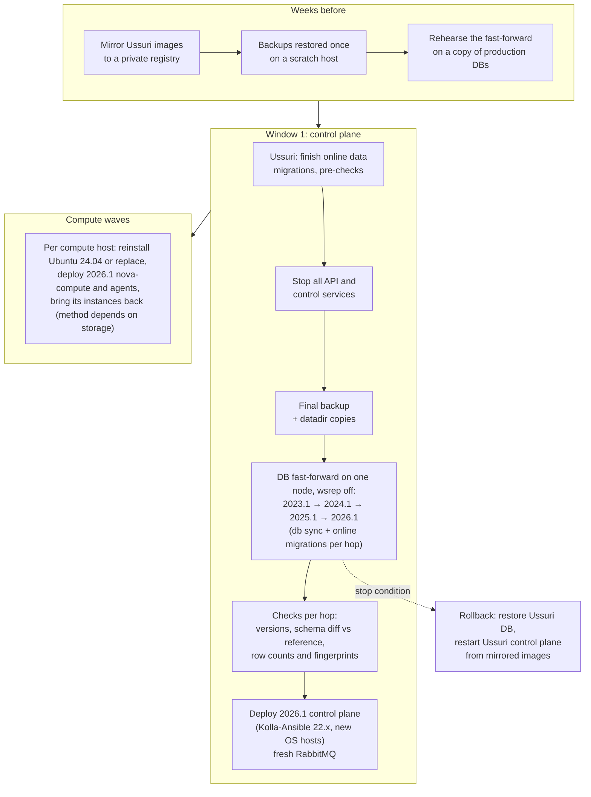

# Migration architecture — Ussuri → 2026.1 (Stage 2 proposals)

| Metadata | |
|---|---|
| Author | Agent 1 — OpenStack Upgrade Architect (Opus) |
| Date | 2026-10-31 |
| Status | `PROPOSED-UNVERIFIED`. Stage 2 proposals; Red Team review (Stage 3) pending; no experiment run yet. |
| Inputs | `assessments/02-*` (compatibility), `03-*` (Kolla-Ansible), `04-*` (database and messaging), `06-*` (operations), `07-red-team-initial-assessment.md`, `compatibility-matrix.md`, `dependency-graph.md`, DR-001, DR-002 |
| Skills applied | `openstack-operational-decisions` (options, gates, trade-offs), `openstack-change-review` (points of no return, decision rights), `openstack-maintenance-planning` (compute waves), `openstack-kolla-ansible-operations` (Galera and Kolla mechanics) |

> [!WARNING]
> No part of this page is a supported or validated procedure. These are proposals that experiments must confirm or
> reject. The independent Red Team will challenge them before any experiment runs.

## 1. What the independent investigations established

All findings below come from reading upstream source and documentation, so they are `DOCUMENTED-UNVERIFIED`. The
architect re-checked items 2, 3 and 4 in the source.

| # | Finding | Classification | Source |
|---|---|---|---|
| 1 | Upstream's only supported route is U→V→W→X→Y→Z→2023.1→2024.1→2025.1→2026.1: 9 upgrades. Steps are N→N+1 before 2023.1, and SLURP steps after. | Officially supported (per hop) | 02, 03 |
| 2 | Nova, Keystone and Cinder 2023.2+ cannot read a legacy (sqlalchemy-migrate) database. Their code that moves a legacy database onto Alembic exists only in **Xena–2023.1 (Nova, Cinder)** and **Zed–2023.1 (Keystone)**. | Incompatible (direct jump) | 02, 04, 07, DR-002 |
| 3 | Some data migrations live in service code and are deleted later. Cinder 2024.1 `9ab1b092a404` makes `use_quota` NOT NULL and relies on the earlier release's online migrations having run. | Incompatible if skipped | 04, 07; architect-checked |
| 4 | Nova 2026.1 refuses to start if any compute service is older than Epoxy (`OLDEST_SUPPORTED_SERVICE_VERSION = 'Epoxy'`). Ussuri computes are version 51. | Incompatible (mixed versions) | 06, 07; architect-checked |
| 5 | Glance, Placement and Neutron still carry their full Alembic chains in 2026.1. Jumping them directly is technically possible but unsupported. | Possible, unsupported | 02, 04 |
| 6 | No Kolla-Ansible release supports both the Ussuri host OS (Ubuntu 18.04 / CentOS 8) and the 2026.1 host OS (Ubuntu 24.04 / Rocky 10). Every host changes OS at least once, or three times on the staircase. | Forced | 03, 06 |
| 7 | Kolla-Ansible 22.x `upgrade` against Ussuri breaks part-way. Python/Ansible, OS checks, MariaDB 10.3→11.4 and the RabbitMQ version check fail first. The Nova check fails only after other services were already migrated. | Incompatible | 03 |
| 8 | RabbitMQ holds no state worth preserving once every service is stopped and queues are drained. A fresh 2026.1 broker is acceptable. | Possible, unsupported as a "path" | 04 |
| 9 | Kolla Ussuri images are no longer anonymously pullable (HTTP 401 from Docker Hub, observed here). Rollback to Ussuri requires a private mirror made **before** the change. | Observed in this environment | DR-001, 03 |
| 10 | Policy (RBAC) defaults change: `enforce_scope` and `enforce_new_defaults` are on by default from oslo.policy 4.4 (2024.2). JSON policy files are unsupported in 2026.1. Keystone 2026.1 rejects `sha512_crypt` password hashes. | Behaviour change | 02 |
| 11 | Nova 2026.1 needs libvirt ≥ 8.0 and QEMU ≥ 6.2. Ussuri-created instances have no recorded machine type. | Workload risk | 06, 07 |

**Consequence.** The answer to the central question cannot be "one direct jump". Intermediate code must run,
because of findings 2 and 3. The question becomes whether that code can run **only against the databases**, offline,
instead of being deployed and operated. The proposals below differ in exactly that respect.

## 2. Proposals

### P1 — Supported staircase (reference)

Nine `kolla-ansible upgrade` runs, each preceded by `install-deps` and configuration changes and followed by online
data migrations:

- U → V → W → X → Y → Z → 2023.1, one release at a time;
- then 2023.1 → 2024.1 → 2025.1 → 2026.1 as SLURP hops.

The host OS moves 18.04 → 20.04 (Victoria), 20.04 → 22.04 (Yoga/Zed) and 22.04 → 24.04 (2024.1). There are two
RabbitMQ and quorum-queue preparations, and MariaDB moves stepwise with Kolla.

- **For:** every hop is supported upstream and tested in CI. Rollback is per hop.
- **Against:** 8 intermediate deployments, 9 maintenance campaigns and 3 OS changes per host. It needs every
  intermediate image (availability not established), and months of calendar time.

### P2 — Offline database fast-forward, then deploy 2026.1 once (Strategies B + D)

Database code sequence (variant S2c of `assessments/04-database-migration-strategy.md`):

1. Ussuri, with the platform running: finish online data migrations.
2. 2023.1: the bridge for Nova, Keystone and Cinder, plus 2023.1 online data migrations.
3. **Cinder only, 2023.2 (cinder 23.5.0)**: `db sync` and online data migrations until 0. This step is added by
   DR-004, because the released 2023.1 Cinder leaves soft-deleted volumes and snapshots with `use_quota` NULL. It is
   followed by the hard gate PC-C1. Classification: technically possible but unsupported.
4. 2024.1, then 2025.1, then 2026.1: SLURP hops, each with `db sync` and online data migrations.

MariaDB follows 10.3 → 10.6 → 10.11 → 11.4 on one node with wsrep off, and Galera is rebuilt afterwards.

Compute transition. While the control plane is migrated and redeployed, Ussuri computes and their instances keep
running, but they are unmanaged: no API operation can act on them. Every compute host then needs a new OS anyway
(finding 6). Per host, by storage type:

- **Shared storage (Ceph RBD, boot-from-volume):** move instances to a host already on 2026.1. Live migration is
  impossible across this gap (finding 4), so the candidate is an operator-controlled restart on another host. The
  exact Nova mechanism (evacuate from a fenced, forced-down Ussuri service, or rebuild of the compute record) is open
  and needs an experiment. Instance UUIDs, ports and volumes are preserved by design.
- **Local ephemeral disks:** either reinstall the host in place while preserving `/var/lib/nova/instances` and the
  hostname, then let 2026.1 nova-compute adopt the instances and hard-reboot them; or cold-copy the disks. Each
  instance is down for its host's reinstall.

**Hard precondition: no old clients before new endpoints** (Red Team RT-B-02). Before the 2026.1 control plane is
reachable at any preserved endpoint, VIP or credential, every Ussuri RPC and HTTP client on compute, network and
storage hosts must be stopped and verified stopped. That covers `nova_compute`, the Neutron agents,
`cinder_volume` and `cinder_backup`; `nova_libvirt` and `openvswitch_vswitchd` keep running so that instances stay up.
The alternative is to network-isolate those hosts from the control-plane VLAN. Verification: `rabbitmqctl
list_consumers` is empty, and `docker ps` is checked on each host. Otherwise Ussuri `nova-compute` would write
inventories to 2026.1 Placement, and 5.x RPC would land on 6.x servers.

**Deploying 2026.1 with Kolla-Ansible on the migrated databases** (Agent 3,
`assessments/03-kolla-deploy-on-migrated-databases.md`, source reading at `kolla-ansible@22.2.0`, `PROPOSED-UNVERIFIED`):

- Use `kolla-ansible deploy`, not `upgrade`, on the new hosts.
- `deploy` does **not** run `nova-status`, the Nova online data migrations or the Cinder online data migrations, so
  the fast-forward must have completed them, and the operator runs `nova-status upgrade check` explicitly.
- `deploy` **changes data on purpose**, so it is wrapped in a database diff before and after:
  - it resets the admin and service-user passwords to the values in `passwords.yml`, re-enables a disabled admin and
    updates endpoint URLs;
  - it deletes the admin→member implied role;
  - it rewrites the message-queue and database URLs of the cell mappings.
- **The default cell name must match Kolla's lookup**, or `create_cell` may create a second mapping to the same
  database.
- **Kolla's "compute registered" wait is satisfied by the old forced-down rows**, so it proves nothing about the new
  compute.
- MariaDB: let Kolla bootstrap an empty Galera cluster, then restore the per-service dumps before any service
  bootstraps.

**The Nova gate is two gates** (Red Team RT-B-01; decision DR-003). The service-version check refuses start-up, and
the compute RPC version cap is computed from the same minimum-version query and cached per process. The sequence is:

1. Fence every Ussuri compute: stop `nova_compute` and the agents, which the precondition above already requires.
   Disable any automatic evacuation (for example Masakari) for the window.
2. Mark every Ussuri `nova-compute` service **forced-down** through the **Ussuri** API (`openstack compute service set
   --down`, never by SQL), after fencing and **before** the final pre-bridge backup. First capture the state of every
   `services` row. This records a state that fencing has already made true. Never delete service or compute-node rows.
3. Start the 2026.1 control plane **without** `disable_compute_service_check_for_ffu`. This is Agent 4's sharpening
   (DR-003), read from source and to be tested as EXP-SVC-01 state (d). With every old row forced-down, Nova sees no
   compute service: start-up passes and no RPC cap is cached. A `TooOldComputeService` refusal therefore proves that a
   row was missed, and is a stop condition. The flag remains a fallback that needs a separate decision.
4. Per host: reinstall, then start 2026.1 `nova-compute` under the **same hostname**, so that the existing compute node
   row is adopted. Verify, then clear forced-down, in that order. Clearing it on a host that is still Ussuri would
   cache RPC 5.11 again.
5. After the last host, **restart** nova-api, nova-conductor and nova-scheduler once. The conductor log must show a
   6.x compute RPC version, and `nova-status upgrade check` must pass "Older than N-1 computes". A host not re-adopted
   in the window stays forced-down and disabled, with a reason.

Agent 4 objected to forced-down as a change to real state. The Red Team ruled that forced-down only records what
fencing has already made true, and that deleting rows would break node adoption. The objection is recorded as
answered, not dismissed, in DR-003. Evacuation (Agent 6's flow) is accepted only for shared-storage instances, and
only after fencing has been proven.

- **For:**
  - Identity and every resource ID are preserved: same databases, same Keystone and Fernet keys.
  - Only one Kolla-Ansible deployment, plus one host OS change per host.
  - No intermediate service is ever operated.
  - The old control plane stays bootable until the point of no return.
- **Against:**
  - Unsupported upstream.
  - Nova object blobs are never re-saved by intermediate services (Agent 4, risk 1).
  - The control plane is offline for the whole window.
  - Compute waves need spare capacity or per-host downtime.
  - The PyPI-built migration code must be replaced in production by exactly the image digests that were rehearsed.

### P3 — Parallel 2026.1 cloud with API-level resource migration (Strategy C, fallback)

Deploy a clean 2026.1 cloud and recreate projects, users, networks, security groups, images, flavors and quotas
through the APIs. Move workloads by exporting disks or volumes and importing them. Preservable identifiers are image
IDs, MACs, fixed IPs and floating IPs. Instance, volume, network, port, project and user UUIDs change (Agent 6,
`06-workload-preservation-strategy.md`).

- **For:** no unsupported database operation at all. The old cloud is untouched until the last workload has moved.
- **Against:**
  - Identifiers change, which breaks tenants' automation, billing and integrations.
  - Downtime per instance equals copy time.
  - Full duplicate capacity is needed.
  - Users must re-authenticate unless a Keystone migration is added. That addition makes it P4.

### P4 — Hybrid: fast-forward the identity and image layers, rebuild the rest (Strategy D)

Fast-forward only Keystone (bridge 2023.1) and Glance (alembic, direct). Keystone IDs, credentials and images are
preserved. Neutron, Nova and Cinder resources are recreated in a parallel 2026.1 cloud as in P3. This avoids the
riskiest database (Nova object blobs) at the cost of changing compute, network and volume IDs.

The Red Team's ruling (Stage 3, ruling 5) corrects the original claim. P4 **relocates** P2's biggest unknown rather
than isolating it: it accepts every cost of P3 and still runs the unsupported Keystone bridge. It is kept as a fallback
only with a table of which IDs cross the line and how each is preserved.

## 3. Comparison matrix (before experiments)

| Criterion | P1 staircase | P2 DB fast-forward | P3 parallel cloud | P4 hybrid |
|---|---|---|---|---|
| Technical feasibility | Supported per hop | Unsupported. Hypothesis to test (EXP-DB-*) | Supported building blocks | Partly unsupported (Keystone bridge) |
| Data preservation | Full (by design) | Full **if** experiments prove it | Partial (IDs change) | Identity and images full, rest partial |
| Workload continuity | Rolling per hop. Host OS changes force instance moves 3 times | Instances keep running while unmanaged. One move or restart per instance | One cutover per instance (copy time) | As P3 |
| Downtime (control plane) | Short per hop, ×9 | One long window (hours, scales with DB size; measured in the experiments) | None for the old cloud | Keystone window only |
| Complexity | High (9 campaigns) | High, concentrated in one rehearsed window | High (tooling for resource recreation) | Highest (both kinds) |
| Automation | Kolla-Ansible per hop | Kolla-Ansible once + fast-forward scripts (new) | Custom migration tooling | Both |
| Recovery | Per hop: DB restore + previous images | Before the point of no return: restore + Ussuri images. After it: forward only | Old cloud untouched | Old cloud untouched for compute; Keystone restore |
| Operational risk | Fatigue, many windows, image availability for 8 releases | Concentrated, untested combination | Tenant-visible changes | Two systems at once |
| Supportability | Upstream-supported path | Unsupported; must be owned locally | Supported pieces | Mixed |

## 4. Experiments required before any recommendation

They run on the container lab of DR-001, always on copies of the preserved Ussuri baseline. Each one gets an
experiment record in `experiments/`.

| ID | Hypothesis | Pass criteria (aligned with the Red Team's pre-registered criteria) |
|---|---|---|
| EXP-DB-00 | The baseline is complete and restorable. | Restore into a fresh MariaDB gives identical row counts and dump checksum. **Every item of the coverage checklist** (`experiments/baseline-coverage-checklist.md`, RT-B-04) has a count > 0, created through Ussuri APIs. T0 records Keystone `migrate_version`, the password hasher per user and `@@GLOBAL.sql_mode`. |
| EXP-DB-01 (main, S2c) | U → 2023.1 → 2024.1 → 2025.1 → 2026.1 migrates every database with no manual edits. | Every command exits 0. Online migrations reach 0. Schema diff against a fresh reference shows only declared differences, from the list **frozen before the run** (`experiments/declared-differences.md`, RT-B-03). Row counts and fingerprints match except declared transformations. Offline status tools show no FAILURE; online checks are under SVC-01. **Idempotency:** a second run of every 2026.1 sync and online migration exits 0 with zero schema change and zero row change. Engine lines: E1 stepwise and E2 dump/restore; also the bridge code against 11.4. E3 is informational only. |
| EXP-DB-02 (reference, S2b) | The full DB staircase U→V→W→X→Y→Z→2023.1→…→2026.1 gives the **same** final data as EXP-DB-01. | Normalised final dumps of 01 and 02 are identical except declared differences. This is the differential test of "skipping is equivalent". |
| EXP-DB-03 (minimal, S2a) | U → 2023.1 → 2026.1 gives the same final data as EXP-DB-01. | As for 02. |
| EXP-DB-N1 (negative) | 2026.1 code refuses a Ussuri database for Nova, Keystone and Cinder. | The predicted error is recorded verbatim. The run is expected to be FAILED, which confirms finding 2. |
| EXP-DB-N2 (negative) | Skipping the Cinder online migrations at the bridge breaks or silently alters `use_quota` at 2024.1. | Observed behaviour under oslo.db's sql_mode is recorded. |
| EXP-SVC-01 | 2026.1 services start on the fast-forwarded databases and serve every pre-existing resource. | Starting state: Ussuri fake computes **stopped**, their service rows at version 51 (RT-B-02). `show` of every server, port, volume, image, project and user equals the T0 inventory, with zero 500 errors. Three gate states are recorded (RT-B-01): **(a)** rows not forced-down, workaround set: services start, `nova-status` FAILURE, conductor log shows RPC cap 5.11, an RPC-bearing operation fails. **(b)** Rows forced-down, then restart: log shows 6.x, the operation succeeds. **(c)** A 2026.1 fake compute adopts a baseline hostname, forced-down is cleared, the workaround is removed, services restart: `nova-status` passes. **(d)**, the preferred P2 mechanism (DR-003): all Ussuri rows forced-down and the flag **not** set. Services start, `nova-status` returns 0 and no RPC cap is cached. Then one host is re-registered and cleared, and the cap is 6.x. The deleted-row refusal path needs the libvirt driver; it is recorded as not demonstrable with the fake driver. |
| EXP-SVC-02 | Pre-existing resources stay operable after the migration. | Resize (fake), volume attach and detach, snapshot, a token for an old user (Fernet and credential keys preserved), and a new port on an old network. |
| EXP-RB-01 (rollback) | Restoring the pre-bridge dump and restarting Ussuri code returns the platform to T0. | Restore from the dump taken before the first 2023.1 `db sync`, start the Ussuri services, and the T0 inventory is identical. What is lost (everything after the dump) is documented. This supports the claim "the old control plane stays bootable until the point of no return" (RT-B-03). For Cinder, the point of no return is the first `db sync`, which now comes before H1b (Red Team Stage 5b). |

**Production prerequisite (RT-B-04, Red Team criterion B.3).** No result on the synthetic Tier A dataset can support
a production decision. A Tier B run on a sanitized copy of the production databases, with Kolla images pinned by
digest, is required before any production go decision.

**Mandatory scope line for any `LAB-VALIDATED` database result** (ruling 4, `docs/templates/experiment-record.md`):
"`LAB-VALIDATED` — scope: database schema and data migration Ussuri → 2026.1 by the S2c code sequence, using
upstream service code installed from PyPI under each release's upper-constraints, standalone MariaDB library images
(no Galera), synthetic Tier A dataset generated through Ussuri APIs with the fake virt driver, no Kolla images, no
Kolla-Ansible, no data plane." Each result also carries the classification **Technically possible but unsupported**
for the procedure itself.

Out of scope for this lab, and listed so that nobody claims them:

- Kolla-Ansible playbooks and configuration transformation;
- host OS upgrade;
- the data plane (QEMU, OVS);
- live behaviour of instances;
- Galera rebuild;
- the RabbitMQ engine upgrade.

These need the quick-lab Kolla Ussuri variant (DR-001, alternative 1).

## 5. Open decisions for the Red Team review (Stage 3)

> **Resolved in Stage 3** (`assessments/07-red-team-stage3-review.md` §5). The resolution of each question:
>
> 1. Fence, then forced-down, then the workaround only for start-up, then restart (DR-003).
> 2. 2023.1 is the bridge, with Zed as a fallback.
> 3. Run both the E1 and E2 engine lines; production defaults to E2 declared as a rebuild, unless vendor documentation
>    and a three-node rehearsal support E1.
> 4. Yes, but only with the mandatory scope line in section 4.
> 5. P4 is kept, with a corrected promise.
>
> The original questions are kept below.

1. Nova service-version gate: `disable_compute_service_check_for_ffu`, forced-down, or another mechanism?
2. Bridge release: 2023.1 (the SLURP start), or Zed? Both are inside all windows (DR-002).
3. Should the engine path be stepwise or dump/restore? This lab can test both on MariaDB library images; production
   behaviour under Galera cannot be tested here.
4. Is a container lab with upstream PyPI code and the fake virt driver enough to move P2's database claim to
   `LAB-VALIDATED`, given that Kolla images are not used?
5. P4 as a risk-reduction fallback: worth keeping?

## 6. Provisional position of the architect

None. The architect does not validate its own architecture (mission rule). The working hypothesis is that P2 is the
most promising way to avoid deploying intermediate releases, and that it stands or falls with EXP-DB-01, 02 and
EXP-SVC-01. P1 remains the reference and the only supported path.
