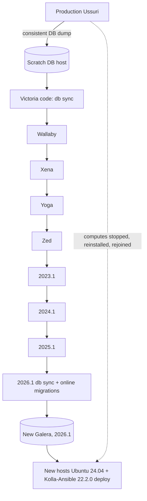

# Draft Kolla-Ansible execution plan, Ussuri to 2026.1

| Field | Value |
|---|---|
| Author | Agent 3, Kolla-Ansible Specialist (OzarLand multi-agent team, Stage 1) |
| Model | Claude Opus (claude-opus-5-5) |
| Date | 2026-10-31 |
| Status | Draft for the architect. **Nothing here was executed.** Every step is `DOCUMENTED-UNVERIFIED` (taken from upstream Kolla-Ansible docs, release notes or code) or `PROPOSED-UNVERIFIED` (my proposal). The only lab evidence in scope is the OzarLand 2025.1→2026.1 all-in-one run (LAB-VALIDATED, draft, KA-ARCH-29), cited where it applies, and it does not validate any step for this platform. |
| Skills applied | `openstack-kolla-ansible-operations` (command choice, blast radius, checks after a run, MariaDB backup/restore), `openstack-change-review` (gates, recovery, point of no return, stop conditions, decision rights), `openstack-automation-review` (pinning, dry runs, judgement vs execution) |
| Inputs | `03-kolla-ansible-assessment.md`, `03-configuration-transformation.md` and their sources |

Assumed starting state (Assumption, to be replaced by facts): Ussuri, Kolla-Ansible 10.x, Ubuntu 18.04 hosts,
Docker, ML2/OVS, three controllers, Galera + RabbitMQ cluster, HAProxy/keepalived, Ubuntu binary images from Docker
Hub. Rocky/CentOS differences are given where they change the plan.

## 1. Paths at a glance

```mermaid
flowchart LR
  U[Ussuri 10.x<br/>Ubuntu 18.04] --> V[Victoria 11.x]
  V -->|host OS 18.04→20.04| V2[Victoria on 20.04]
  V2 --> W[Wallaby 12.x] --> X[Xena 13.x] --> Y[Yoga 14.x]
  Y -->|host OS 20.04→22.04<br/>here or after Zed| Z[Zed 15.x]
  Z --> A1[2023.1 16.x SLURP]
  A1 -->|SLURP| C1[2024.1 18.x]
  C1 -->|host OS 22.04→24.04| C2[2024.1 on 24.04]
  C2 -->|SLURP| E1[2025.1 20.x]
  E1 -->|SLURP| G1[2026.1 22.x]
```

| Path | Kolla-Ansible upgrades | Intermediate releases running | Host OS changes (Ubuntu) | Classification |
|---|---|---|---|---|
| A. Standard, operated hops | 9 | 8, each operated for a soak period | 3, rolling per host | Officially supported per hop; DOCUMENTED-UNVERIFIED as a chain |
| B. Compressed in-place chain | 9 (same) | 8, each only long enough to verify | 3 (they set the window boundaries) | Each hop supported; compressing the soak is an operational choice, PROPOSED-UNVERIFIED |
| C. Parallel rebuild, databases migrated offline | 0 upgrades on production; 1 `deploy` of 2026.1 | 0 in production; 8 series of service code run only against copies of the databases | 0 in place: new hosts | Technically possible but unsupported; PROPOSED-UNVERIFIED |

No path removes the eight intermediate series from the **database** history: path C only moves them off the
production control plane.

## 2. Gates before any path (Phase 0)

Every item is a go/no-go gate (change-review). If one fails, the journey does not start.

| # | Step | Kind | Status |
|---|---|---|---|
| 0.1 | Inventory facts: Kolla-Ansible version installed and its git ref or PyPI version, `globals.yml`, inventory, overrides, enabled services, network backend, storage backends, host OS of every host, Docker version, image registry and tags actually running (`docker ps --format '{{.Image}}'`). Secrets redacted. | read-only | PROPOSED-UNVERIFIED |
| 0.2 | **Image availability gate.** For each series Victoria…2026.1 and for each image in the deployment's set, prove the image can be pulled from a registry the platform will use (quay.io `openstack.kolla` from a host that reaches it, an authenticated Docker Hub account, a vendor mirror, or local builds). Mirror into a local registry under one namespace with the original tags, before the first hop. Without this, stop. | read-only on platform | PROPOSED-UNVERIFIED (Docker Hub `kolla/*` refused anonymous manifests here: Observed) |
| 0.3 | Deploy-host toolchain per hop: one venv or container per series with a Python accepted by both that Kolla-Ansible and that Ansible line (Ussuri/Victoria: Python 3.6–3.8 with Ansible 2.9; Wallaby–2023.1: 3.8+; 2023.2–2025.1: 3.10; 2025.2–2026.1: 3.12). Pin Kolla-Ansible to the last release of each series (PyPI) and `ansible-collection-kolla` to the `*-eol` tag where the branch is gone (Yoga, Zed, 2023.1, 2023.2, 2024.2) by editing `requirements.yml` | state-changing (deploy host only) | PROPOSED-UNVERIFIED |
| 0.4 | Dropped services and Linux Bridge decided (decisions C1, C2 of the transformation doc). A Linux Bridge deployment must be migrated before 2025.1; dropped services must be gone before the hop that removes them | decision | PROPOSED-UNVERIFIED |
| 0.5 | Database backup **restored once** on a scratch host; `/etc/kolla` and inventory in git; `passwords.yml` vault-encrypted. Kolla `mariadb_backup` exists in Ussuri (bash CLI name `mariadb_backup`) and needs `enable_mariabackup: yes` + `reconfigure -t mariadb` | state-changing (MariaDB containers may restart) | DOCUMENTED-UNVERIFIED (2026.1 procedure LAB-VALIDATED KA-OPS-12/14 on 2026.1 only) |
| 0.6 | Rehearsal lab: a disposable multinode copy with the same inventory structure and a copy of the databases runs the whole path end to end first | state-changing (lab) | PROPOSED-UNVERIFIED |
| 0.7 | Decision rights: named owner for go/no-go at each hop, at each host OS change and at each point of no return | decision | PROPOSED-UNVERIFIED |

## 3. Path A: standard hops (and path B, the same steps compressed)

### 3.1 The procedure repeated at every hop

From each release's `doc/source/user/operating-kolla.rst` ("Upgrade procedure"), with the skill's safety rules:

| Step | Command / action | Kind | Status |
|---|---|---|---|
| H1 | Health baseline: `kolla-ansible check` (where available; removed in Zed and reintroduced later), Galera size/state, `rabbitmqctl cluster_status`, `openstack compute service list`, `network agent list`, `volume service list`, `docker exec nova_api nova-status upgrade check` (current code), one test instance | read-only (+ one test VM) | DOCUMENTED-UNVERIFIED (2026.1 checks LAB-VALIDATED KA-CMD-15) |
| H2 | MariaDB backup taken and verified (content, not file presence), copied off host; `/etc/kolla` committed | state-changing (backup) | DOCUMENTED-UNVERIFIED |
| H3 | Activate the next series' deploy-host venv (keep the previous one: it is the way back before H8) | deploy host | DOCUMENTED-UNVERIFIED (2025.1→2026.1 notes step 2) |
| H4 | From Yoga on: `kolla-ansible install-deps` (collection pinned) | deploy host | DOCUMENTED-UNVERIFIED |
| H5 | Transform inventory, `globals.yml`, overrides for this hop; `kolla-genpwd` on a new sample + `kolla-mergepwd`; set `docker_registry`/`docker_namespace` to the local mirror; remove pinned tags | files | DOCUMENTED-UNVERIFIED |
| H6 | Docker daemon settings changed by this hop applied deliberately (manual `daemon.json` + reload, or `bootstrap-servers --limit` per host in a window), never as a side effect | state-changing | DOCUMENTED-UNVERIFIED (KA-CMD-14, lab report) |
| H7 | `kolla-ansible pull` then `kolla-ansible prechecks` (2026.1 with own registry, not `--use-test-images`); from 2023.1 also `genconfig` + `validate-config` and compare with the baseline errors | read-only for services | DOCUMENTED-UNVERIFIED |
| H8 | **`kolla-ansible upgrade`** (no `--limit`: operating guide warns, bug 2054348). Point of no return for this hop: schema migrations | *Destructive* (no downgrade) | DOCUMENTED-UNVERIFIED |
| H9 | Checks of H1 again, with the new code; Nova online data migrations are run by Kolla-Ansible's `nova.yml` plays (verify they finished: `nova-manage db online_data_migrations` reports nothing left) — they are a prerequisite of the **next** hop | read-only | DOCUMENTED-UNVERIFIED |
| H10 | Remove old images only after the soak (they are the fastest way back with a restore); `prune-images` does not remove tagged images (lab) | state-changing | LAB-VALIDATED (KA-ARCH-30, 2026.1 only) for the observation; step DOCUMENTED-UNVERIFIED |

Stop conditions for every hop (PROPOSED-UNVERIFIED): any `prechecks` failure; Galera not `Synced`/`Primary` or
size wrong; RabbitMQ partitions or alarms; `nova-status upgrade check` rc ≥ 2 with the new image (Kolla stops by
itself); any service down after H8 not recovered within the agreed window; any test instance failure. After H8,
recovery = restore databases and `/etc/kolla`, redeploy previous images with the previous venv, losing changes since
the backup.

### 3.2 Hop table

Columns: KA = Kolla-Ansible release to install (last of the series), Ansible = range to install with it.

| Hop | From → To | KA | Ansible | Host OS during the hop | Hop-specific steps (in addition to H1–H10) | Status |
|---|---|---|---|---|---|---|
| 1 | Ussuri → Victoria | 11.4.0 | `ansible>=2.9,<2.10` | Ubuntu 18.04 (Victoria precheck accepts bionic) | Inventory I1 (common groups); Octavia `octavia_auto_configure: no` if used; images become Ubuntu 20.04 based | DOCUMENTED-UNVERIFIED |
| OS-1 | Victoria, host OS 18.04 → 20.04 | 11.4.0 | same | rolling, one host at a time | Controllers one at a time (Galera/RabbitMQ quorum kept), then network, then computes after live-migrating instances away; after each host: `kolla-ansible deploy --limit <host>`‐style redeploy or `bootstrap-servers` for that host only, checks H1. Upstream gives only the order ("containers first, then hosts"); the per-host procedure is ours. Docker on the upgraded host restarts every container on it | PROPOSED-UNVERIFIED (order DOCUMENTED-UNVERIFIED) |
| 2 | Victoria → Wallaby | 12.8.0 (≥ 12.2.0 mandatory, LP#1941706 fixed) | `ansible>=2.9,<2.11` | Ubuntu 20.04 | Chrony: decide C3, `enable_chrony: no` + `kolla-ansible chrony-cleanup` + host NTP; Docker iptables default change (applied only via `bootstrap-servers`); Prometheus v2 decision; Monasca Grafana/Log Metrics removals; Trove config merge; Cinder v2 endpoints removed | DOCUMENTED-UNVERIFIED |
| 3 | Wallaby → Xena | 13.9.0 | `ansible-base 2.10` / `ansible>=3,<5` (core ≤ 2.11) | Ubuntu 20.04 | **`haproxy` → `loadbalancer` group** (precheck fails otherwise); default registry quay.io and type **source** (set registry and decide `kolla_install_type` C4); `docker_registry_insecure` default false; chrony role removed; Prometheus v1 removed; MariaDB 10.3 → 10.5 | DOCUMENTED-UNVERIFIED |
| 4 | Xena → Yoga | 14.11.0 | `ansible>=4,<6` (core 2.11–2.12) | Ubuntu 20.04 | Admin endpoints no longer created (old ones stay; clean up later); Keystone `member` role default; Ironic renames; MariaDB 10.6; binary images deprecated | DOCUMENTED-UNVERIFIED |
| OS-2 | Ubuntu 20.04 → 22.04 | 14.11.0 (Zed doc) **or** 15.6.0 after hop 5 (Yoga doc) | — | rolling per host | Choose one order (decision C7) and stick to it; Yoga precheck accepts jammy, Zed precheck accepts focal. Same per-host pattern as OS-1. CentOS path instead: **reprovision CentOS Stream 8 → Rocky Linux 9 in Yoga** per `rocky-linux-9.rst` (per-host `kolla_base_distro`, OVN cluster leave/join, `mariadb_recovery` if APIs fail randomly) | DOCUMENTED-UNVERIFIED (order), PROPOSED-UNVERIFIED (per-host steps for Ubuntu) |
| 5 | Yoga → Zed | 15.6.0 | `ansible>=5,<7` (core 2.12–2.13) | 20.04 or 22.04 | **Binary images gone**: source images mandatory; new image names (`<svc>:zed-ubuntu-jammy`); Elasticsearch→OpenSearch (back up ES, rename groups); Monasca/Kafka/Storm/Zookeeper removed (`monasca_cleanup`); Keystone admin port removed (check external users); `kolla-ansible check` removed | DOCUMENTED-UNVERIFIED |
| 6 | Zed → 2023.1 | 16.7.0 | `ansible>=6,<8` (core 2.13–2.14; 2.14 needs Python ≥ 3.9 on the deploy host) | Ubuntu 22.04 (2023.1 accepts jammy only) | RabbitMQ 3.10 → 3.11 (rolling, version check introduced); RabbitMQ definitions change (restart); containers get systemd units; Skydive gone | DOCUMENTED-UNVERIFIED |
| 6b | 2023.1: RabbitMQ 3.11 → 3.12 in place | 16.7.0 | same | 22.04 | Before the SLURP hop: `rabbitmq_image: …/rabbitmq-3-12` in `globals.yml` then `kolla-ansible deploy --tags rabbitmq` (idempotent variant) or `kolla-ansible rabbitmq-upgrade 3.12` (not idempotent) | DOCUMENTED-UNVERIFIED (2024.1 `rabbitmq.rst` SLURP section) |
| 6c | 2023.1: queues to durable/quorum | 16.7.0 | same | 22.04 | Required "before a SLURP upgrade to Caracal": `genconfig`; `stop --tags <services>`; `reconfigure --tags rabbitmq` (if HA flag was used); `rabbitmq-reset-state`; `deploy --tags <services>`. OpenStack APIs and RPC unavailable during the procedure; running VMs unaffected (Hypothesis) | DOCUMENTED-UNVERIFIED |
| 7 | 2023.1 → 2024.1 (SLURP) | 18.8.0 | `ansible-core>=2.15,<2.17` | 22.04 | Skip-level upgrade per 2024.1 operating guide (upgrade Ansible explicitly, `install-deps`); RabbitMQ 3.12 → 3.13; MariaDB 10.6 → 10.11; Horizon override file renames; dropped Murano/Sahara/Senlin/Solum/Vitrage/Freezer must already be gone; Nova accepts N-1 SLURP computes (computes upgraded in the same run) | DOCUMENTED-UNVERIFIED |
| OS-3 | Ubuntu 22.04 → 24.04 | 18.8.0 | — | rolling per host | 2024.1 support matrix: Noble hosts may run Jammy (default) or Noble images; keep Jammy images through the host change (one change at a time). No upstream guide found: per-host pattern as OS-1 | PROPOSED-UNVERIFIED |
| 8 | 2024.1 → 2025.1 (SLURP) | 20.6.0 | `ansible-core>=2.17,<2.19` | 24.04 (2025.1 accepts noble only) | Quorum queues mandatory (`om_enable_rabbitmq_high_availability` removed; durable procedure "required before any upgrade to Epoxy" if not done); RabbitMQ 3.13 → 4.0/4.1 allowed; Python CLI (`mariadb-backup`), ProxySQL default since 2024.2 (decide C8; new passwords); Linux Bridge and Swift removed; Prometheus v3 (the note asks for "version 2.5.5 or later" running first, presumably 2.55; verify); `innodb_log_file_size` 2 GB (disk) | DOCUMENTED-UNVERIFIED |
| 8b | 2025.1 preparation for 2026.1 | 20.6.0 | same | 24.04 (Rocky path: **reprovision Rocky 9 → 10 here**, `rocky-linux-10.rst`, `migrate-valkey`) | Redis → Valkey switch (`enable_redis: "no"`, `enable_valkey: "yes"`) set before hop 9 | DOCUMENTED-UNVERIFIED |
| 9 | 2025.1 → 2026.1 (SLURP) | 22.2.0 | `ansible-core>=2.19,!=2.19.0,<2.21` (2.20 needs Python ≥ 3.12) | 24.04 | Follow OzarLand version notes 2025.1→2026.1: inventory `kolla_toolbox`/`kolla_logs`/Neutron groups, Cinder groups, Valkey, RabbitMQ path (`rabbitmq_allowed_upgrades` 4.0/4.1 → 4.2), ProxySQL mandatory, uWSGI, Horizon 8080; own registry (prechecks refuse quay `openstack.kolla` without `--use-test-images`) | DOCUMENTED-UNVERIFIED; one all-in-one lab run LAB-VALIDATED (KA-ARCH-29, draft, not multinode) |
| F | Post-journey clean-up | 22.2.0 | — | — | Remove leftover admin endpoints, `cinderv2`, catalog entries of removed services, unused databases and Keystone users of removed services (after C1), old images and volumes; `kolla-mergepwd --clean` | PROPOSED-UNVERIFIED |

Deploy host changes: Ubuntu 18.04 (or a Python 3.6–3.8 container) for hops 1–2; Python 3.8 for 3–6 (2.14 at hop 6
needs 3.9 → use 2.13 or a 3.10 venv); Python 3.10 for 7–8; Python 3.12 for 9 (PROPOSED-UNVERIFIED; controller
requirements from PyPI metadata, Observed).

### 3.3 Path B: what changes when the chain is compressed

Same steps; only the time between hops shrinks (hours instead of weeks). PROPOSED-UNVERIFIED.

- Groupings that fit one maintenance window each (host OS changes set the boundaries):
  W1: hop 1; W2: OS-1 (rolling, several nights); W3: hops 2–4; W4: OS-2 (if done in Yoga) then hop 5; W5: hops 6, 6b,
  6c, 7; W6: OS-3; W7: hops 8, 8b, 9.
- Preconditions for compressing: path A rehearsed end to end on the lab (0.6); every hop's images mirrored and every
  hop's venv built before W1; H1/H9 checks scripted; a restore point per window (backup after each hop, before the
  next H8).
- What is lost: the soak period that catches slow failures (stuck online migrations, leaking agents, performance).
  Mitigation: keep H9's online-migration completion check as a hard gate between hops.
- Computes: each hop recreates `nova_compute`, `nova_libvirt`, `openvswitch_*` containers. Running instances
  survived one 2025.1→2026.1 run with one 2 s floating IP gap (KA-ARCH-29); for earlier hops, behaviour of
  `nova_libvirt` restarts is release-specific (Wallaby LP#1941706): rehearse.

## 4. Path C: parallel rebuild with offline database migration

Technically possible but unsupported. PROPOSED-UNVERIFIED in full. Recommended only if path A/B is blocked (for
example by image availability for the hosts' distribution, or host OS upgrade risk).

| Step | Action | Kind | Status |
|---|---|---|---|
| C-1 | Build the 2026.1 target configuration from the Ussuri one with all transformation rows at once (`03-configuration-transformation.md`), keeping every secret (P4) and the same inventory hostnames for computes | files | PROPOSED-UNVERIFIED |
| C-2 | Rehearsal: dump production databases (consistent, `mariabackup` or `mysqldump --single-transaction` per DB), load into a scratch MariaDB, run each service's migrations series by series using that series' images (`keystone`, `glance-api`, `neutron-server` + enabled sub-projects, `nova-api`/`nova-conductor`, `placement-api`, `cinder-api`, `heat-api`, …) with the commands in assessment section 7, including Nova/Cinder/Placement online data migrations at every step; MariaDB major versions stepped 10.3→10.5→10.6→10.11→11.4 by loading into the matching `mariadb-server` image or by dump/restore | lab | PROPOSED-UNVERIFIED |
| C-3 | Validate the migrated databases: 2026.1 `nova-status upgrade check` with `[workarounds] disable_compute_service_check_for_ffu` only if the service specialists confirm its use, `keystone-manage doctor`, `neutron-db-manage current`, row counts and spot checks | lab | PROPOSED-UNVERIFIED |
| C-4 | Deploy 2026.1 on new controller/network hosts (Ubuntu 24.04, own registry) with `deploy` against the migrated databases; Keystone credential keys and Fernet handling per open question | state-changing (new hosts) | PROPOSED-UNVERIFIED |
| C-5 | Cut-over window: freeze production APIs, final dump, replay C-2 on it (timed in rehearsal), load, start 2026.1 control plane | *Destructive* for the old control plane state (point of no return once tenants write to 2026.1) | PROPOSED-UNVERIFIED |
| C-6 | Computes: stop instances (or accept their loss of control), reinstall Ubuntu 24.04 keeping instance storage, `deploy --limit` the compute, start/hard-reboot instances; with shared Ceph instances can start on any new compute. Full workload outage per compute | *Destructive* | PROPOSED-UNVERIFIED |
| C-7 | Clean-up as F | state-changing | PROPOSED-UNVERIFIED |

Path C still needs images (or source code) of eight intermediate series, but only for a handful of services and
only in a lab; it removes three in-place host OS upgrades and eight production upgrades, at the cost of a full
data-plane outage and an unsupported procedure.

## 5. Where the host OS upgrades go (summary)

| Distribution | Transition | Place in path A/B | Path C |
|---|---|---|---|
| Ubuntu | 18.04 → 20.04 | OS-1, after hop 1 (Victoria) | not needed (new hosts) |
| Ubuntu | 20.04 → 22.04 | OS-2, in Yoga (before hop 5) or in Zed (after hop 5) | not needed |
| Ubuntu | 22.04 → 24.04 | OS-3, in 2024.1 (between hops 7 and 8) | not needed |
| CentOS/Rocky | CentOS 8 → Stream 8 | before or during Victoria (Ussuri-eol `-centos8s` suffix) | not needed |
| CentOS/Rocky | Stream 8 → Rocky 9 | Yoga (reprovision), before hop 5 | not needed |
| CentOS/Rocky | Rocky 9 → 10 | 2025.1 (reprovision), before hop 9 | not needed |
| Deploy host | per hop venvs/containers (section 3.2) | every hop | one 2026.1 host + lab toolchains |

## 6. Open questions / what I could not verify

1. Image availability for every series (gate 0.2) is unknown; it can decide between paths.
2. The per-host Ubuntu release-upgrade procedure under running Kolla containers (OS-1/2/3) is not documented upstream
   and has not been rehearsed; reprovisioning per host (as the Rocky guides do) may be safer.
3. Whether each service's migrations really require every pre-2023.1 series (the specialists own this; the plan
   assumes yes).
4. RabbitMQ 3.8 → 3.9 → … path inside hops 1–6 relies on each Kolla-Ansible release's own upgrade logic (rolling only
   from 2023.1; full stop before); the feature-flag state across 3.8→3.13 was not checked.
5. MariaDB 10.3 → 10.5 (Galera 3 → 4) inside hop 3 is done by Kolla-Ansible Xena's normal upgrade; whether a
   rolling restart is safe across that boundary was not checked.
6. Durations per hop are unknown; the only measured run is 24 min for an all-in-one 2025.1→2026.1 upgrade.
7. Behaviour of running instances during `nova_libvirt` recreation in hops 1–8 (only hop 9 has lab evidence).

Validation: lab-tested (2025.1→2026.1, Kolla-Ansible 22.2.0, all-in-one, ML2/OVS, draft report): parts of hop 9 and
the H1/H10 observations only. Not tested: every other step in this plan (from documentation, code, or proposed here).
Nothing here is validated in production.

> Decision support only. State-changing steps above require approval by the accountable owner and should be executed
> under your change process.
