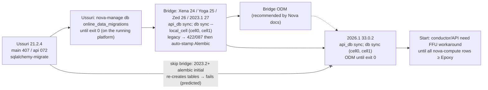
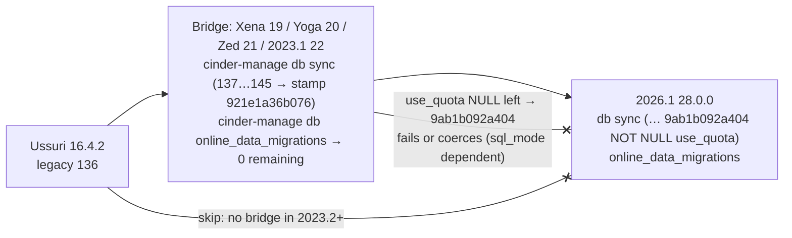
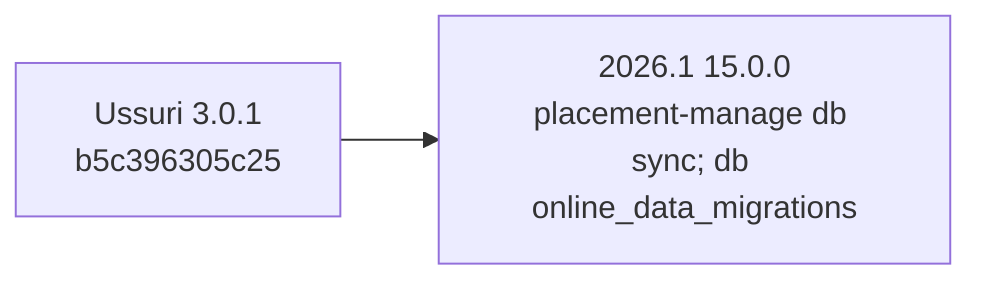
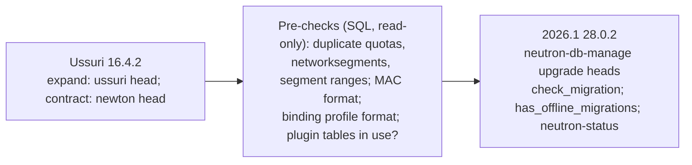
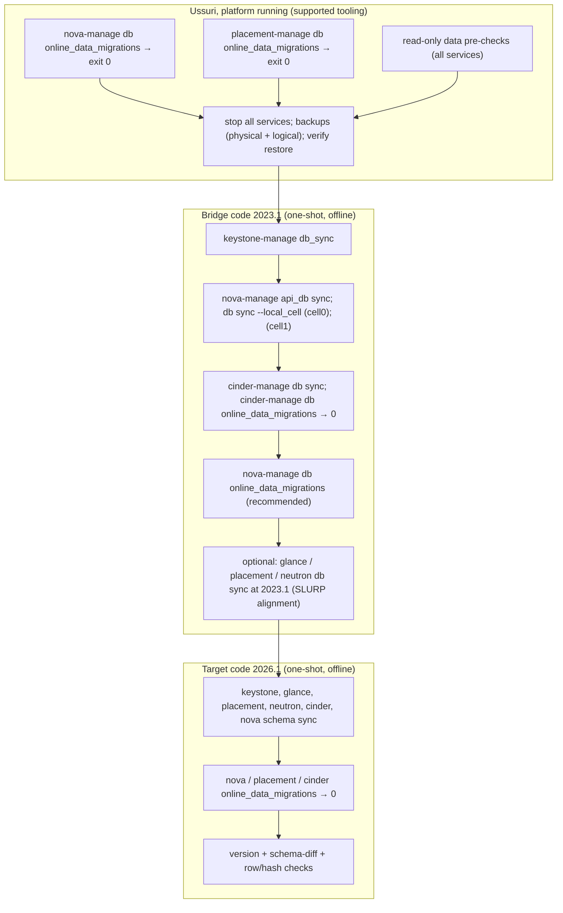

# 04 — Database migration dependency graph (Ussuri → 2026.1)

> **Architect correction (2026-10-31):** the Keystone bridge window is Zed to 2023.1, not Yoga to 2023.1. See
> [DR-002](../decision-records/DR-002-keystone-bridge-window-disagreement.md). The original text is kept below.

| Metadata | |
|---|---|
| Author | Agent 4 — Database and Messaging Specialist (Stage 1, independent investigation) |
| Model | Opus (claude-opus-5-5) |
| Date | 2026-10-31 |
| Status | Source analysis only. Nothing here was executed. Every procedure is `PROPOSED-UNVERIFIED`. |
| Inputs read | `00-mission-brief.md`; OzarLand skills `openstack-kolla-ansible-operations` (+ `references/host-and-database-operations.md`), `openstack-incident-analysis` (`references/control-plane-recovery.md`), `openstack-change-review`; upstream trees `/home/user/src/{nova,neutron,keystone,glance,cinder,placement,oslo.db,requirements,kolla,kolla-ansible,releases}` at the refs cited below. |

Citation format: `repo@ref:path`. Refs used: `ussuri-eol`, `victoria-eol`, `wallaby-eol`, `xena-eol`,
`origin/unmaintained/yoga`, `origin/unmaintained/zed`, `origin/unmaintained/2023.1`, `2023.2-eol`,
`origin/unmaintained/2024.1`, `2024.2-eol`, `origin/stable/2025.1`, `origin/stable/2025.2`, `origin/stable/2026.1`.
Kolla and Kolla-Ansible also use `yoga-eol`, `zed-eol`, `2023.1-eol`.

## 1. Answer in one paragraph

Reading the code shows that the database layer does **not** need every intermediate release deployed. It needs
**one intermediate code version** for three services, between Xena and 2023.1. Nova, Keystone and Cinder
removed their sqlalchemy-migrate → Alembic bridge in 2023.2. Cinder 2024.1 also makes `use_quota` NOT NULL, which assumes that an
online data migration has already run, and only Xena–2023.1 ship that migration. Glance, Placement and Neutron
can, by their code, go from the Ussuri schema straight to 2026.1. The smallest code sequence that is
*technically possible* is therefore **Ussuri (pre-checks, finish online migrations) → one bridge release (2023.1
Antelope is the only release inside every window) → 2026.1**. All of it can run offline against the database with
only a config file, apart from the Nova checks that need the Placement/Cinder APIs. Skipping releases this way is **Technically possible but unsupported**. The officially
supported path is N→N+1 up to 2023.1 and then SLURP (2023.1→2024.1→2025.1→2026.1). Nothing here has been validated.
The experiment in `04-database-migration-strategy.md` is what can establish it.

## 2. Release ↔ package versions (for one-shot environments)

From `releases@origin/master:deliverables/<series>/<project>.yaml` (last numeric version per series):

| Series | nova | neutron | keystone | glance | cinder | placement | kolla / kolla-ansible |
|---|---|---|---|---|---|---|---|
| Ussuri | 21.2.4 | 16.4.2 | 17.0.1 | 20.2.0 | 16.4.2 | 3.0.1 | 10.4.0 / 10.4.0 |
| Victoria | 22.4.0 | 17.4.1 | 18.1.0 | 21.1.0 | 17.4.0 | 4.0.0 | 11.3.0 / 11.4.0 |
| Wallaby | 23.2.2 | 18.6.0 | 19.0.1 | 22.1.1 | 18.2.1 | 5.0.1 | 12.7.0 / 12.8.0 |
| Xena | 24.2.1 | 19.7.0 | 20.0.1 | 23.1.0 | 19.3.0 | 6.0.0 | 13.10.0 / 13.9.0 |
| Yoga | 25.3.0 | 20.5.0 | 21.0.1 | 24.2.1 | 20.3.2 | 7.0.0 | 14.12.0 / 14.11.0 |
| Zed | 26.3.0 | 21.2.1 | 22.0.2 | 25.1.0 | 21.3.2 | 8.0.0 | 15.6.0 / 15.6.0 |
| 2023.1 Antelope | 27.5.1 | 22.2.1 | 23.0.2 | 26.1.0 | 22.3.0 | 9.0.0 | 16.6.0 / 16.7.0 |
| 2023.2 Bobcat | 28.3.1 | 23.5.0 | 24.1.0 | 27.1.1 | 23.5.0 | 10.0.1 | 17.9.0 / 17.9.0 |
| 2024.1 Caracal | 29.4.0 | 24.2.2 | 25.0.0 | 28.2.0 | 24.5.0 | 11.0.1 | 18.8.0 / 18.8.0 |
| 2024.2 Dalmatian | 30.3.0 | 25.2.3 | 26.1.1 | 29.2.1 | 25.3.1 | 12.0.2 | 19.8.0 / 19.8.0 |
| 2025.1 Epoxy | 31.3.1 | 26.0.6 | 27.1.0 | 30.2.0 | 26.4.0 | 13.0.1 | 20.6.0 / 20.6.0 |
| 2025.2 Flamingo | 32.2.1 | 27.0.4 | 28.1.0 | 31.1.0 | 27.0.0 | 14.0.0 | 21.3.0 / 21.3.0 |
| 2026.1 Gazpacho | 33.0.2 | 28.0.2 | 29.1.0 | 32.0.0 | 28.0.0 | 15.0.0 | 22.2.0 / 22.2.0 |

`pip index versions` from this environment lists e.g. nova 21.2.4, 24.2.1, 27.5.1, 33.0.2; cinder 16.4.2, 19.3.0,
22.3.0, 28.0.0; keystone 23.0.2, 29.1.0; openstack-placement 3.0.1, 15.0.0; sqlalchemy-migrate 0.13.0 on PyPI.
That a package is listed does not mean it installs; installability is not validated.

Upper-constraints (`requirements@<ref>:upper-constraints.txt`): SQLAlchemy 1.3.16 (Ussuri) → 1.4.23 (Xena) →
1.4.41 (2023.1) → 2.0.32 (2024.2) → 2.0.46 (2026.1); `sqlalchemy-migrate===0.13.0` is pinned up to and including
`origin/unmaintained/2024.1`, absent from 2024.2 onward. Python: the setup.cfg classifiers list 3.6/3.7 for Ussuri, 3.6–3.8 for Xena and
3.8–3.10 for 2023.1 (nova, cinder; keystone/glance/neutron/placement list 3.8–3.9). 2026.1 has `requires-python = ">=3.10"`
(`<repo>@<ref>:setup.cfg` / `pyproject.toml`).

## 3. Summary per service

| Service | Framework at Ussuri | Ussuri DB state | Legacy squash | Alembic introduced (initial rev ⇔ legacy version) | Legacy bridge removed | Online/data migrations | **Mandatory code checkpoints** |
|---|---|---|---|---|---|---|---|
| Nova (API DB, cell0, cell1) | sqlalchemy-migrate | main 407, api 072 (`nova@ussuri-eol:nova/db/sqlalchemy/{migrate_repo,api_migrations/migrate_repo}/versions`) | Wallaby: `402_train.py`, `067_train.py` (commits `5c9c81e0f9`, `df89596edb`) | Xena: main `8f2f1571d55b`, api `d67eeaabee36`; stamped after legacy reaches 422 / 087 | 2023.2 (`fd39e4b4be`, 28.0.0) | `nova-manage db online_data_migrations`; list is **cumulative** through 2026.1 | Ussuri (finish ODM) → **one of Xena/Yoga/Zed/2023.1** (`api_db sync`, `db sync` ×cell0, cell1) → 2026.1 |
| Keystone | sqlalchemy-migrate (expand/data/contract repos) | expand/data/contract 079, legacy `migrate_repo` 109 | Yoga: legacy repos squashed to 073–079, old `migrate_repo` removed (`503421d3d`, `3e2b01d5f`) | Yoga: `27e647c0fad4`, `MIGRATE_INIT_VERSION = 72` | 2023.2 (`8c9462f6f`, 24.0.0) | none since Yoga (`migrate_data()` is a no-op) | Ussuri → **one of Yoga/Zed/2023.1** (`db_sync`) → 2026.1 |
| Cinder | sqlalchemy-migrate | 136 (`cinder@ussuri-eol:cinder/db/sqlalchemy/migrate_repo/versions`) | Xena: `135_cinder_init` + 136…145 | Xena: `921e1a36b076`, `MIGRATE_INIT_VERSION = 134` | 2023.2 (`e9dccb93b`) | `use_quota` ODM only in Xena–2023.1; **blocked on by** `9ab1b092a404` (2024.1) | Ussuri → **one of Xena/Yoga/Zed/2023.1** (`db sync` **and** `online_data_migrations` to zero) → 2026.1 |
| Glance | Alembic since Ocata (+ legacy repo still shipped) | `ussuri_expand01` / `ussuri_contract01` | n/a | `liberty` initial | legacy `migrate_repo` gone in Xena (irrelevant: Ussuri DB already Alembic) | `data_migrations/*` only run for `CURRENT_RELEASE`; all post-Ussuri ones are empty | Ussuri → 2026.1 (no intermediate needed by code) |
| Placement | Alembic since Stein | `b5c396305c25` | n/a | `b4ed3a175331` | n/a | `set_root_provider_ids`, `create_incomplete_consumers` retained through 2026.1 | Ussuri → 2026.1 |
| Neutron | Alembic since Kilo, expand/contract | expand `ussuri/expand/*`, contract last in Newton | none (all scripts retained back to `kilo_initial.py`) | n/a | n/a | none in code; data fixes are separate CLI tools still shipped in 2026.1 | Ussuri → 2026.1 (data pre-checks required) |

## 4. Per-service details and graphs

Legend for the graphs: solid box = code version that **must** execute; dashed = optional / recommended;
red-labelled edge = point where a later code version refuses or corrupts if the checkpoint was skipped.

### 4.1 Nova

**Evidence**

- Ussuri legacy heads: main `402_add_resources.py` + placeholders `403–407`; API `062_instance_mapping_add_user_id.py`
  + placeholders to `072` (`nova@ussuri-eol:nova/db/sqlalchemy/...`). Victoria and Wallaby add **only placeholders**
  (`nova@victoria-eol`, `nova@wallaby-eol`, `408–417`, `073–082`), so Ussuri…Wallaby share one schema.
- Wallaby compacts history into `402_train.py` / `067_train.py` (`5c9c81e0f9`, `df89596edb`).
- Xena adds Alembic: `nova@xena-eol:nova/db/migration.py` has `MIGRATE_INIT_VERSION = {'main': 401, 'api': 66}`,
  `ALEMBIC_INIT_VERSION = {'main': '8f2f1571d55b', 'api': 'd67eeaabee36'}`. `db_sync()` checks
  `_is_database_under_migrate_control and not _is_database_under_alembic_control`. If the DB is still under
  sqlalchemy-migrate, it runs `migrate_api.upgrade()` (to 422 / 087 placeholders) and then `alembic_api.stamp(...)`
  (**auto-stamp after completing legacy**). Legacy repos live in `nova/db/{main,api}/legacy_migrations` from Xena
  to `origin/unmaintained/2023.1`.
- 2023.2 removes the bridge: `fd39e4b4be` "db: Remove legacy migrations" (first tag 28.0.0.0rc1; **not** an
  ancestor of `origin/unmaintained/2023.1`). `nova@2023.2-eol:nova/db/migration.py` just calls
  `alembic upgrade head`. The initial revisions have no guard (`get_table_names`/`has_table` absent). On a DB
  without `alembic_version`, 2023.2+ would therefore run the initial migration and try to create existing tables. Expected failure:
  "table already exists". **Not validated**. Discrepancy: `doc/source/reference/database-migrations.rst` in that
  same commit says "removed in 27.0.0 (Antelope)", but the code shows removal in 28.0.0 (2023.2).
- Alembic revisions after the initial one (first release containing them):
  main `16f1fbcab42b` resolve_shadow_table_diffs (Yoga), `ccb0fa1a2252` BDM encryption fields (Zed),
  `960aac0e09ea` de-duplicate indexes (2023.1), `1b91788ec3a6` drop `migrate_version` (2023.2),
  `1acf2c98e646` `instances.compute_id`, `migrations.dest_compute_id` (2023.2), `13863f4e1612` share_mapping
  (2024.1), `d60bddf7a903` share_mapping constraint, `2903cd72dc14` console tls_port (2025.1).
  API `b30f573d3377` drop 15 `build_requests` columns (Yoga), `cdeec0c85668` drop `migrate_version` (2023.2).
  None of them is a "blocker" migration (none checks for un-migrated data).
- Online data migrations (`nova/cmd/manage.py`, `online_migrations` tuple): Ussuri has 9 functions; Wallaby adds
  `PciDevice.populate_dev_uuids`; 2023.2 adds `instance_obj.populate_instance_compute_id`. **Every function is still
  present in `nova@origin/stable/2026.1`**, so 2026.1 code contains all earlier Nova data migration code. Nova's own
  rule, though, is that the online migrations of a release must be complete "before the next upgrade"
  (`nova@origin/stable/2026.1:doc/source/admin/upgrades.rst`, "After maintenance window").
- Online migrations need the API DB **and** the cell DBs reachable through `cell_mappings.database_connection`
  (`populate_queued_for_delete`, `populate_user_id` call `CellMappingList.get_all` + `target_cell`,
  `nova@origin/stable/2026.1:nova/objects/instance_mapping.py`). Kolla-Ansible stores literal URLs there
  (`kolla-ansible@ussuri-eol:ansible/roles/nova/tasks/map_cell0.yml`, `nova-cell/tasks/create_cells.yml`).
- `populate_instance_compute_id` resolves `ComputeNode.get_by_host_and_nodename(instance.host, instance.node)` and
  logs an error, leaving the row, when the node is gone (`nova@origin/stable/2026.1:nova/objects/instance.py`).
  Instances whose compute node record no longer exists will stay "found, not done". Treat this as an expected residue to
  explain, not a failure to force.
- Service-version gate: `nova/utils.py:raise_if_old_compute()` (introduced `aa7c6f8769`, Wallaby) is called by every
  service at start (`nova/service.py`, `nova/api/openstack/wsgi_app.py`). It fails if the minimum `nova-compute`
  version (non-deleted, not forced-down: `nova/db/main/api.py:service_get_minimum_version`) is below
  `OLDEST_SUPPORTED_SERVICE_VERSION`, which is `'Epoxy'` (68) in 2026.1. Ussuri computes report 51.
  `[workarounds]disable_compute_service_check_for_ffu` (`e8b079a91e`, first in 23.2.1, present in 2026.1) turns it
  into a warning. **`nova-status upgrade check` ("Older than N-1 computes") still returns FAILURE regardless of the
  workaround** (`nova/cmd/status.py:_check_old_computes`). Kolla-Ansible 2026.1 aborts the Nova upgrade when
  `nova-status` returns rc not in [0, 1] (`kolla-ansible@origin/stable/2026.1:ansible/roles/nova/tasks/upgrade.yml`).
  This is not a schema issue, but it means a DB fast-forward still needs a planned Nova start-up sequence.
- `nova-status upgrade check` in 2026.1 contains: Cells v2, Placement API (needs Keystone + Placement running,
  min microversion 1.36), Cinder API (needs the Cinder endpoint), Older than N-1 computes, hw_machine_type unset,
  Service User Token Configuration. It cannot be fully run offline.



### 4.2 Keystone

**Evidence**

- Ussuri…Xena: expand/data_migration/contract repos all at `079_*_update_local_id_limit.py`, old `migrate_repo` at
  `109_add_password_self_service_column.py` (`keystone@{ussuri,victoria,wallaby,xena}-eol:keystone/common/sql/*_repo/versions`).
  So the schema did not change from Ussuri to Xena.
- Yoga: migrations squashed per release (`6525ae297` … `3e2b01d5f` "sql: Squash ussuri migrations"), old
  `migrate_repo` removed (`503421d3d`), moved to `legacy_migrations/` (`aebd037f5`), Alembic initial `27e647c0fad4`
  (`afce7ca8e`, `b547f6727`), `MIGRATE_INIT_VERSION = 72`.
  `keystone@origin/unmaintained/2023.1:keystone/common/sql/upgrades.py:_init_alembic_on_legacy_database` upgrades the
  three legacy repos, then `alembic_api.stamp(config, '27e647c0fad4')` (auto-stamp). `migrate_data()` prints
  "Data migrations are no longer supported with alembic. This is now a no-op."
- 2023.2 removes the legacy repos (`8c9462f6f`, release note `remove-sqlalchemy-migrate-a4fa47685c7e28c6.yaml`:
  "deprecated since Zed, have been removed. There should be no end-user impact"). The note assumes deployments
  passed through a bridge release.
- Later revisions: Bobcat expand `11c3b243b4cb`, `b4f8b3f584e0` (new unique constraint `duplicate_trust_constraint`
  on `trust` — fails on duplicate trusts, Not validated); Bobcat contract `99de3849d860`, `c88cdce8f248`;
  2024.1 `47147121` (`mapping.schema_version`); 2025.2 `e8725d6fa226` (index); 2026.1 `742c857f1dfb` (two indexes on
  `revocation_event`, a table that can be large).
- Kolla-Ansible toggles `log_bin_trust_function_creators` around Keystone upgrades because legacy rolling upgrades
  used triggers (`kolla-ansible@origin/stable/2026.1:ansible/roles/keystone/tasks/upgrade.yml`). Leftover triggers
  from an interrupted Ussuri-era rolling upgrade must be checked before migrating (`information_schema.TRIGGERS`).

```mermaid
flowchart LR
  U["Ussuri 17.0.1<br/>expand/data/contract 079"]
  B["Bridge: Yoga 21 / Zed 22 / 2023.1 23<br/>keystone-manage db_sync<br/>legacy 079 (no-op) → stamp 27e647c0fad4"]
  N["2026.1 29.1.0<br/>keystone-manage db_sync (expand + contract)"]
  U --> B --> N
  U -- "Xena code: still legacy-only, does not stamp" -.-> B
  U -- "skip: 2023.2+ has no bridge" --x N
```

### 4.3 Cinder

**Evidence**

- Ussuri head `136_make_vol_type_col_non_nullable.py` (a blocker migration that raises unless untyped volumes were
  migrated; already passed on Ussuri). Victoria adds `140_create_project_default_volume_type`, Wallaby
  `141_add_quota_usage_unique_constraint` (`cinder@{victoria,wallaby}-eol:cinder/db/sqlalchemy/migrate_repo/versions`).
- Xena: squash `135_cinder_init` + `136…145` (incl. **`145_add_use_quota_fields`**, nullable `use_quota`), Alembic
  initial `921e1a36b076`, `MIGRATE_INIT_VERSION = 134`, same auto-stamp logic
  (`cinder@xena-eol:cinder/db/migration.py`). Legacy present through `origin/unmaintained/2023.1`, removed in
  2023.2 (`e9dccb93b`, note `remove-sqlalchemy-migrate-c62b541fd5f4ab10.yaml`).
- Online migrations (`cinder/cmd/manage.py`): `volume_use_quota_online_data_migration`,
  `snapshot_use_quota_online_data_migration` exist in Xena, Yoga, Zed, 2023.1 and **not** in 2023.2+.
  2023.2…2026.1 carry `remove_temporary_admin_metadata_data_migration` instead.
- **Blocker**: `cinder@origin/stable/2026.1:cinder/db/migrations/versions/9ab1b092a404_make_use_quota_non_nullable.py`
  (first in 24.0.0 / 2024.1) does `alter_column('use_quota', nullable=False, server_default=true())` with the
  comment "It's safe … because … the online migrations from the previous release must already have been run". It
  contains no check. If NULL rows remain, the result depends on the session `sql_mode`. oslo.db's default
  `mysql_sql_mode=TRADITIONAL` should make the ALTER fail. A non-strict mode would silently coerce NULL to 0
  (= false), so the volumes stop counting toward quota. **Not validated.** In both cases the 2026.1 code cannot repair it.
- Other 2024.1 revisions: `b8660621f1b9` (resize `resource` on `quotas`, `quota_classes`, `reservations`;
  catches the MySQL error and only logs it), `b7b88f50aab5` (soft-deletes consistencygroup quota rows using ORM
  models), `9c74c1c6971f` (inserts default backup quota classes from **config values** `quota_backups`,
  `quota_backup_gigabytes`, so the config used for the one-shot run matters). 2023.1 `daa98075b90d`, indexes on
  volumes/snapshots/backups/groups. Zed `c92a3e68beed`, ALTER on `volumes.shared_targets`.



### 4.4 Glance

**Evidence**

- Alembic with expand/contract since Ocata; Ussuri adds empty `ussuri_expand01`, `ussuri_contract01`,
  `ussuri_migrate01` (`glance@ussuri-eol:glance/db/sqlalchemy/alembic_migrations/`).
- 2026.1 still ships every revision from `liberty_initial` on. Post-Ussuri schema revisions:
  `wallaby_expand01_add_user_imageid_requestid_to_tasks`, `2024_1_expand01_add_cache_tables`, the rest empty.
- Data migrations: `glance@origin/stable/2026.1:glance/db/sqlalchemy/alembic_migrations/data_migrations/__init__.py`
  runs only modules whose name starts with `CURRENT_RELEASE` (`'2026_1'` in `glance/db/migration.py`). Earlier
  data migrations (`ocata_migrate01_community_images`, `train_migrate01_backend_to_store`) are **never run by
  2026.1 code**. Every post-Ussuri data migration (`wallaby`, `xena`, `yoga`, `zed`, `2023_1`, `2024_1`) is
  `has_migrations() → False`. So, judging from the code, no intermediate Glance code is needed, provided the Ussuri DB has
  no pending Train/Ocata data migration (check: no `image_locations.meta_data` containing `"backend":`).
- `glance-manage db sync` = expand + migrate + contract with `USE_TRIGGERS = False`
  (`glance/cmd/manage.py:sync`); `glance-manage db check` gives exit codes 3/4/5 for expand/migrate/contract needed.

```mermaid
flowchart LR
  U["Ussuri 20.2.0<br/>ussuri_expand01 / ussuri_contract01"]
  P["Pre-check on Ussuri: no image_locations rows with '\"backend\":'<br/>no leftover glance triggers"]
  N["2026.1 32.0.0<br/>glance-manage db sync; db check → exit 0"]
  U --> P --> N
```

### 4.5 Placement

**Evidence**: Alembic since extraction (`b4ed3a175331_initial`, Stein blockers `611cd6dffd7b`, `b5c396305c25` already
passed by Ussuri). New: `422ece571366` consumer_types (6.0.0/Xena), `a082b8bb98d0` drop redundant indexes
(10.0.0/2023.2) (`placement@origin/stable/2026.1:placement/db/sqlalchemy/alembic/versions`). Online migrations
`set_root_provider_ids`, `create_incomplete_consumers` unchanged through 2026.1 (`placement/cmd/manage.py`).



### 4.6 Neutron

**Evidence**

- All migration scripts since `kilo_initial.py` are still present in 2026.1. The contract branch has had no new
  revision since Newton. Every revision from Victoria to 2026.1 is under `<release>/expand/`
  (`neutron@origin/stable/2026.1:neutron/db/migration/alembic_migrations/versions`). `neutron-db-manage upgrade heads`
  from 2026.1 therefore has, judging from the code, everything it needs.
- Data-sensitive expand revisions that can fail or **change data**:
  - `wallaby/expand/f010820fc498` unique (`project_id`,`resource`) on `quotas`. Duplicates make it fail.
  - `yoga/expand/e981acd076d3` unique on `networksegments(network_id, network_type, physical_network)`, then
    `2023.1/expand/fc153938cdc1` replaces it with a constraint that includes `segment_index`. Duplicates make it fail.
    `neutron-status` 2026.1 has "NetworkSegments unique constraint check".
  - `2024.1/expand/054e34dbe6b4` **drops** Cisco/VMware/Brocade/Nuage plugin tables.
  - `yoga/expand/8160f7a9cebb` drops `portbindingports`; `2023.2/expand/93f394357a27` drops `subnets.in_use`.
  - `2025.2/expand/d553edeb540f` `ALTER TABLE tags CONVERT TO CHARACTER SET utf8mb4 COLLATE utf8mb4_bin`
    (table rebuild; only logs if the collation is unknown).
  - `2026.1/expand/b1bca967e19d` rewrites NULL `physical_network` to `''` and **deletes duplicate
    `network_segment_ranges` rows** before adding a unique constraint.
- Data-fix tools that are not migrations, still shipped in 2026.1 (`pyproject.toml`):
  `neutron-sanitize-port-mac-addresses`, `neutron-sanitize-port-binding-profile-allocation`,
  `neutron-remove-duplicated-port-bindings`. `neutron-status upgrade check` points to them
  (`neutron/cmd/upgrade_checks/checks.py`).
- Out of scope but required before trusting this: neutron sub-projects (fwaas, vpnaas, dynamic-routing, sfc…) have
  their own Alembic branches and version tables and must be installed in the same one-shot environment. With
  ML2/OVN, the OVN NB/SB databases are separate state and are not covered here.



## 5. Combined minimal checkpoint graph



Why 2023.1 and not Xena/Yoga/Zed: 2023.1 is the only release inside all three windows (Nova Xena–2023.1,
Keystone Yoga–2023.1, Cinder Xena–2023.1). It is also a SLURP release, and from it the supported skip-level chain is
2023.1 → 2024.1 → 2025.1 → 2026.1. Its upper-constraints still pin `sqlalchemy-migrate===0.13.0` and SQLAlchemy 1.4.41.
A more conservative variant (strategy document, option S2b) runs **every** release's `db sync` and online migrations
in sequence. It costs more but stays closer to how upstream tests upgrades.

## 6. Classification

| Claim | Status |
|---|---|
| Upgrading DB schemas N→N+1 with the documented tools, then 2023.1→2024.1→2025.1→2026.1 (SLURP) | **Officially supported** (with deployed services; Nova docs explicitly allow running db sync from a venv: `nova@origin/stable/2026.1:doc/source/admin/upgrades.rst`) |
| Running the db sync / online migrations of a release in an offline one-shot container without deploying it | **Technically possible but unsupported** as a skip-level procedure; Not validated |
| Ussuri → 2023.1 code directly (skipping V, W, X, Y, Z) | **Technically possible but unsupported**; by the code, Victoria/Wallaby/Xena schema changes are all replayed by the 2023.1 legacy repos (Nova placeholders only; Cinder 137–145 kept; Keystone unchanged) |
| Ussuri → 2023.2 or later code directly for Nova, Keystone, Cinder | **Incompatible** (no legacy bridge; predicted failure, Not validated) |
| Ussuri → 2026.1 code directly for Glance, Placement, Neutron | **Technically possible but unsupported**; Not validated |
| Hand-stamping `alembic_version` (`alembic stamp`, `glance-manage db version_control`, `placement-manage db stamp`) to get past a refusal | **Incompatible with data integrity** — it would skip real migrations (e.g. Cinder 140/141/145). Never do it. |

## 7. Open questions / what I could not verify

- Nothing was executed; every failure mode above marked "predicted" needs the experiment.
- Whether 2023.1 code (SQLAlchemy 1.4, PyMySQL 1.0.2) works against MariaDB 10.11/11.4 — unknown; the experiment
  should run the bridge on 10.6 (2023.1's Kolla MariaDB) and, separately, on 11.4.
- Other enabled services of the real Ussuri deployment (Heat, Octavia, Barbican, Designate, Magnum, Manila, Ironic,
  Aodh/Gnocchi…) were **not analysed**; each needs the same table before a decision.
- Neutron sub-projects and ML2/OVN state not analysed.
- Exact behaviour of Cinder `9ab1b092a404` with residual NULLs under Kolla's session `sql_mode` — unknown.
- Whether Kolla-Ansible's `create_cell` stored a literal or templated URL in `cell_mappings` on the actual deployment —
  read it from the real `nova_api.cell_mappings` (without copying the password into documents).
- The legacy `repository_id` names in `migrate_version` must match those of the 2023.1 legacy repos. The
  `migrate.cfg` files agree (`keystone_expand`, `keystone_contract`, `cinder`, `nova`, `nova_api` at both
  `ussuri-eol` and `origin/unmaintained/2023.1`). Whether sqlalchemy-migrate then accepts the Ussuri version
  numbers against the squashed repos is Not validated.
