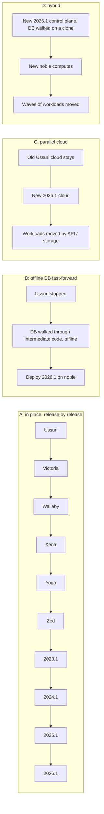

# Operational risk assessment: Ussuri to 2026.1

| | |
|---|---|
| Author | Agent 6, OpenStack Operations and Reliability Expert (OzarLand multi-agent team, Stage 1, independent investigation) |
| Model | Sonnet (high reasoning) |
| Date | 2026-10-31 |
| Status | `PROPOSED-UNVERIFIED`. Nothing in this file was executed on a lab by this mission. Source reading and skill content are not validation. |
| Inputs read | `00-mission-brief.md`; OzarLand skills `openstack-maintenance-planning` (+ `host-maintenance-mechanics.md`), `openstack-change-review` (+ `upgrade-readiness.md`), `openstack-operational-decisions`, `openstack-vm-troubleshooting` (`instance-networking.md`, `compute-host-events.md`), `openstack-incident-analysis` (`control-plane-recovery.md`), `openstack-control-assessment` (`control-spectrum.md`), `openstack-kolla-ansible-operations` (`architecture-implications.md`, `host-and-database-operations.md`); `kolla-ansible-deployment-patterns/version-notes/` (2025.1 to 2026.1 notes and lab report); upstream trees (`nova`, `kolla-ansible`, `glance`, `keystone`, `neutron-lib` wheel) cited inline. |
| Companion files | `06-workload-preservation-strategy.md`, `06-recovery-and-rollback-plan.md` |

Evidence vocabulary used: **Officially supported**, **Technically possible but unsupported**, **Experimentally validated** (none here), **Not validated**, **Incompatible**. Procedure statuses: `PROPOSED-UNVERIFIED`, `DOCUMENTED-UNVERIFIED`, `LAB-VALIDATED` (only where a skill carries that tag from OzarLand's own lab, cited as such; those labs were on 2026.1 and are not this journey's lab), `NEEDS-REVALIDATION`.

Assumed topology (the brief asked for a realistic one; it is an assumption, not a fact about any real cloud): 3 controllers with Galera and a RabbitMQ cluster behind HAProxy and keepalived; N computes with libvirt/KVM in the `nova_libvirt` container; ML2/OVS, gateways on controllers or network nodes; Cinder on LVM or Ceph; Glance on file or Ceph; Horizon; Ubuntu 18.04 hosts as the brief states. Every number of hosts, instances, volumes and bytes is `unknown`.

---

## 0. Summary (read this first)

1. **The question changes shape once the host OS is considered.** Kolla-Ansible Ussuri supports Ubuntu Bionic (18.04) as host (`kolla-ansible@ussuri-eol:doc/source/user/support-matrix.rst:21`). Victoria lists Focal (`@victoria-eol` same file), Zed and 2023.1 list Jammy, 2025.1 and 2026.1 list only Noble (24.04) (`@origin/stable/2025.1`, `@origin/stable/2026.1`). No Kolla-Ansible release lists both Bionic and Noble. Every compute, controller and network host therefore needs an OS change somewhere on the journey, and any host reboot or reinstall takes its instances down unless they are moved first. **Officially supported** (the matrix), consequence inferred.
2. **Nova 2026.1 refuses to run with computes older than Epoxy (2025.1)**: `OLDEST_SUPPORTED_SERVICE_VERSION = 'Epoxy'` (`nova@origin/stable/2026.1:nova/objects/service.py:284`), bypassable only with `[workarounds]/disable_compute_service_check_for_ffu` (same file, comment above the constant), which exists for skip-level test jobs. And libvirt/QEMU minimums moved from 4.0.0/2.11.0 (`nova@ussuri-eol:nova/virt/libvirt/driver.py:225-226`) to 8.0.0/6.2.0, with 10.0.0/8.2.2 announced next (`nova@origin/stable/2026.1:nova/virt/libvirt/driver.py:207-210`). So **a 2026.1 control plane cannot manage Ussuri computes, and a Ussuri-era hypervisor stack cannot be driven by 2026.1 nova-compute.** Whatever the database path, the compute side has to be rebuilt on new libvirt/QEMU, which is the real driver of instance downtime. **Officially supported** (code), **Incompatible** (mixing Ussuri compute with 2026.1 control plane in production).
3. **Control-plane downtime and instance downtime are different things.** A control plane outage of hours is survivable for running instances in the cases the OzarLand skills observed (see section 2), but it is not the thing that forces instance downtime. The forcing events are: host reboot or reinstall, container replacement where QEMU is not detached from the container, and libvirt/QEMU incompatibility on restart or migration.
4. **Most operationally sound family, in my view: D (hybrid) built on a side-by-side 2026.1 control plane plus rebuilt (or new) noble computes, with workloads moved in waves**, with the old cloud left intact and bootable as the rollback target until each wave is verified. Reason: it is the only family in which the old state is never modified until the new state is proven, it does not require operating eight intermediate releases, and its worst case is "stay on the old cloud longer". Its cost is that identifiers change for some resources and it needs spare hardware (see section 5). This is a view on operational risk only; the database-migration feasibility belongs to other agents, and D's control-plane step depends on their finding that a fast-forward is possible and verifiable.
5. **Backups that have never been restored are not backups** (`openstack-control-assessment`, "We have backups" definition in `control-spectrum.md`). This is the single most important gate before any irreversible step.
6. **Old Kolla images are a recovery dependency.** The brief reports that Docker Hub `kolla/*` Ussuri-to-Yoga tags are listed `inactive` and answer 401 anonymously. This is a finding to verify, not a certainty. If true, a rollback that has to redeploy Ussuri containers on a rebuilt host cannot pull them. Local copies on every host plus a private registry mirror are a prerequisite (section 6, gate G2).

---

## 1. Strategy families at operational level

| | A. In place, release by release | B. Offline fast-forward, then 2026.1 | C. Parallel cloud, migrate workloads | D. Hybrid |
|---|---|---|---|---|
| Intermediate deployments you must operate | 8 (Victoria, Wallaby, Xena, Yoga, Zed, 2023.1, 2024.1, 2025.1), then 2026.1. 9 upgrade operations. Skip-level (SLURP) is only available from 2023.1 onward (see the 2025.1 to 2026.1 notes, "Upgrade path"; the 2023.1 to 2024.1 and 2024.1 to 2025.1 Kolla-Ansible skip-levels were not checked by me: `DOCUMENTED-UNVERIFIED`) | 0 deployed; intermediate code is run only as migration tooling (feasibility owned by other agents) | 0 | 0 intermediate; one new 2026.1 |
| Support status | **Officially supported** path per release (sequential), no skipping before SLURP begins | **Technically possible but unsupported** (no OpenStack project documents Ussuri to 2026.1 fast-forward; Nova has the `disable_compute_service_check_for_ffu` hook only as a test workaround) | Not an upgrade: **Officially supported** as two independent clouds; the migration tooling is yours | Mixed: control-plane step as B, compute/workload step as C |
| Old state preserved while new state is proven | No (each step mutates the only copy; only restore-from-backup returns) | Only if the walk runs on a copy of the database | Yes, fully | Yes, if the database walk runs on a copy |
| Identifiers preserved | All | All database-backed ones (same database lineage) | Some (see companion file) | Control-plane IDs preserved; instance disks and domain XML are recreated, UUIDs preserved if the Nova DB is carried |
| Spare hardware needed | Little, but headroom for repeated host drains (3+ OS changes per host) | Little, plus a scratch environment for rehearsal | Large: a second cloud sized for the migrated workload | Medium to large: new computes and 3 controllers (can be carved from drained old hosts only as waves progress) |
| Time to finish | Months of calendar time (9 windows plus soak periods) | Weeks of preparation, one large window | Months (data copy bound) | Weeks to months |

`[PROPOSED-UNVERIFIED]` for every row: derived from source reading and the skills, not from a lab. The "8 intermediate deployments" count is arithmetic on the release train in the brief.

---

## 2. Workload preservation: what happens to running instances

Method: `openstack-vm-troubleshooting` for data-plane behaviour, `openstack-maintenance-planning` for host work, `openstack-incident-analysis` for control-plane failure behaviour. The lab evidence quoted comes from OzarLand's 2026.1 labs (Kolla-Ansible 22.2.0, ML2/OVS). **None of it was run on Ussuri, bionic hosts, or this journey's lab.** Treat it as the best available prior, tag `DOCUMENTED-UNVERIFIED` for Ussuri behaviour, `NEEDS-REVALIDATION` on this stack.

### 2.1 Control plane down for hours: what keeps running

The book's rule, quoted by `operating-principles.md`: the control plane and the data plane fail separately; stopping APIs, bus or databases does not stop running instances, but new state does not propagate. Verify per backend.

| Mechanism | Behaviour with control plane down | Evidence | Risk for a multi-hour outage |
|---|---|---|---|
| Running QEMU processes | Keep running; Nova only reads libvirt. With Kolla-Ansible 2026.1, `nova_libvirt` has `pid_mode: host`, so QEMU outlives the container; on the 2025.1 to 2026.1 lab "running instances never stopped (same qemu PIDs)" | `kolla-ansible@origin/stable/2026.1:ansible/roles/nova-cell/defaults/main.yml` (`pid_mode: host`, `cgroupns_mode: host`); `compute-host-events.md` (VM-HOST-16 `LAB-VALIDATED`); `architecture-implications.md` (KA-ARCH-29 `LAB-VALIDATED`, all-in-one) | **Ussuri unknown.** My grep of `kolla-ansible@ussuri-eol:ansible/roles/nova/defaults/main.yml` did not find a `pid_mode` setting for the libvirt service (`Not validated`: the file shape differs and my search may have missed it). If Ussuri's `nova_libvirt` does not use the host PID namespace, **replacing that container stops every VM on the host.** First check on the live cloud: `docker inspect -f '{{.HostConfig.PidMode}}' nova_libvirt`. |
| OVS flows, security group enforcement (native firewall) | Flows live in ovs-vswitchd; the OVS agent only programs them. Graceful agent restart keeps flows (new cookie, old removed after resync) when `drop_flows_on_start=False`; 0 of 295 requests lost on lab | `instance-networking.md` "Restarting the OVS agent" (VM-NET-29 `LAB-VALIDATED`) | **ovs-vswitchd restart is not free.** Stopped vswitchd: traffic kept flowing 6-25 s from kernel-cached flows, then every instance on that host lost network (VM-NET-18). The 2025.1 to 2026.1 lab saw one 2 s floating IP gap when vswitchd was recreated (KA-ARCH-29). An upgrade step that recreates `openvswitch_vswitchd` is a data-plane event per host. |
| Security groups with the hybrid iptables driver | Rules are kernel state (iptables on `qbr`/`tap` bridges); persist while host is up | General Neutron behaviour, `Not validated` for Ussuri here | The 2026.1 notes list `drop-legacy-iptables` / `neutron_legacy_iptables` removal (`2025.1-to-2026.1.md`). Which firewall driver the Ussuri cloud uses (hybrid vs native `openvswitch`) is **unknown** and changes how ports are plumbed; a change of driver on a running host generally needs a re-plug (live migration or reboot). `Not validated`. Open question for the network agents. |
| DHCP agent / dnsmasq | Existing leases are kept. Lab: running instances lost 0 requests during 180 s and 7.5 min DHCP agent outages. New instances get no address | `instance-networking.md` "No IP address" (VM-NET-01/-02 `LAB-VALIDATED`) | **Not run: an outage longer than the lease** (`dhcp_lease_duration`, default 86400 s). Many guests renew at half the lease, so a multi-hour outage is probably inside the margin, but a multi-day freeze, a cloud with a shorter configured lease, or a guest that reboots and re-requests during the outage would lose its address. Read the actual `dhcp_lease_duration`. `Not validated`. |
| Metadata (neutron-metadata-agent, haproxy per network, nova-api metadata) | Existing instances do not need it after boot; new boots and reboots of cloud-init guests that re-query it fail or fall back to cached data | Inferred; no skill lab for a long outage | Instances created or rebooted during the outage may come up without keys or hostname. Freeze creates and reboots; announce it. `Not validated`. |
| L3 agent / routers / floating IPs | `qrouter-` namespace, NAT and floating IPs are kernel state and stay when the agent stops: 0 of 264 requests lost during a 120 s outage; 0 of 432 after restart (legacy routers) | `instance-networking.md` "Router on a dead L3 agent" (VM-NET-25/-27 `LAB-VALIDATED`) | Changes to routers/floating IPs do not apply while the agent is down. **Not run: L3 HA (keepalived), DVR.** With HA routers the keepalived child processes may die when the agent container is recreated, causing failover; this is a top rehearsal item. A **network node reboot** (OS change) destroys the namespaces until the agent rebuilds them: that is an outage for every legacy router on it. |
| Message bus down (RabbitMQ) | Instances keep running. Computes and agents show `down`; builds hang | `control-plane-recovery.md` (IA-CP-01/-02 `LAB-VALIDATED`) | A memory alarm on one node blocked publishers cluster-wide on the lab, and a retrying client can create a second instance. During a planned outage, put the API into controlled degradation (reject writes) rather than let clients retry into an unstable bus. |
| Galera down | Instances keep running; every API call fails | `host-and-database-operations.md` | Restore is `Destructive` and takes every API down (KA-OPS-14 `LAB-VALIDATED` on ~100 MB; large DB time-outs not run). |
| Cinder volumes (iSCSI/LVM, Ceph RBD) | Attached volumes keep working (data path is host-to-storage). Create/attach/detach/extend stop | Inferred from architecture; `volumes.md` covers stuck states | Attach/detach in flight when the plane drops leave stale attachments (`volumes.md` "Stale attachment"). Freeze volume operations before the window. |
| Nova state sync after the plane returns | Nova syncs power state with libvirt; with `resume_guests_state_on_host_boot=False` (default), guests are not restarted after a host boot and come back `SHUTOFF` | `host-maintenance-mechanics.md` (MP-MECH-02 `LAB-VALIDATED`) | If the outage includes host reboots, the instance list after return can show `ACTIVE` stale, then `SHUTOFF` about a minute after nova-compute is back (`compute-host-events.md`). |

**Conclusion (section 2.1)** `[DOCUMENTED-UNVERIFIED]`: a control-plane outage of hours, with no host reboot and no `ovs-vswitchd`/`nova_libvirt` recreation, is expected to be survivable by running instances. The outage is not the forcing event; the host and container replacements that accompany a release change are. The part that must be proven on this cloud's own stack is the three unknowns above: Ussuri `nova_libvirt` PID mode, firewall driver, and keepalived/HA behaviour.

### 2.2 What forces instance downtime

Listed from most to least certain. "Forces" means: with the stated starting conditions, no supported or documented alternative avoids a guest stop.

| # | Forcing event | Why | Who is hit | Mitigation (does not remove it, only shrinks or moves it) | Status |
|---|---|---|---|---|---|
| F1 | **Host OS reinstall/upgrade** (Bionic to Noble, or stepwise through Focal and Jammy) | Reboot ends QEMU; Kolla-Ansible host OS matrix has no overlap between Ussuri (Bionic) and 2026.1 (Noble) | Every instance left on the host | Live migrate away first (needs a compatible target, see F3); otherwise coordinated stop/start | **Officially supported** (matrix); consequence inferred |
| F2 | **Instances whose disks are on the host** (nova local store, `/var/lib/docker/volumes/nova_compute/_data`) and the host is reinstalled | The disk is wiped unless copied; block live migration copies the disk over the network, cold migration copies it | Local-disk instances | Block live migration (lab: 32-34 s per instance, 1.8-8.6 s ping gaps, one 5-minute outage with no restart and no cause found, MP-MECH-01) or snapshot-and-rebuild | `LAB-VALIDATED` on 2026.1 same-version only; Ussuri to anything `Not validated` |
| F3 | **Libvirt/QEMU version distance** | Nova supports one libvirt/QEMU window per release; Ussuri minimum 4.0.0/2.11.0, 2026.1 minimum 8.0.0/6.2.0 (sources above). Ubuntu 18.04 ships libvirt 4.0 and QEMU 2.11, which is below Victoria's minimum (`NEXT_MIN` in Ussuri = 5.0.0/4.0.0) unless the cloud archive packages or the Kolla image carry newer ones. The version actually running in `nova_libvirt` is `unknown` | Any live migration between hosts whose versions are far apart; any guest hard reboot that regenerates XML on a stack that no longer knows its machine type | Read `virsh version` and each domain's `<type machine=...>` first; keep source and target within what the intermediate Nova release supports | Migration across very old and new QEMU: **Not validated** (QEMU's own versioned-machine-type deprecation policy is the open point) |
| F4 | **Machine type unknown to the new QEMU** | An instance started under a versioned machine type (`pc-i440fx-bionic`, `pc-i440fx-2.x`) can fail to start under a QEMU that dropped it. Nova records machine type per instance only since Wallaby (`nova@origin/stable/2026.1:doc/source/admin/hw-machine-type.rst`: recorded at compute start-up and spawn; `SHELVED_OFFLOADED` ones need `nova-manage libvirt update_machine_type`) | Instances never started on a Wallaby-or-later compute (every instance, if the compute side jumps straight from Ussuri hosts to 2026.1) | `nova-manage libvirt list_unset_machine_type` and `nova-status upgrade check` flag unrecorded ones. Record before the jump, test a hard reboot of a canary of each machine type on the target QEMU | **Not validated**: the exact set of machine types QEMU 8.2 on Noble still accepts is not read |
| F5 | **`nova_libvirt` container replacement when QEMU is not detached** | If Ussuri's container does not use the host PID namespace, QEMU ends with the container | All instances on the host | `docker inspect` check first; if `PidMode` is empty, treat every libvirt container change as a host drain | `Not validated` for Ussuri |
| F6 | **Network node reboot with legacy (non-HA) routers** | Namespaces are kernel state; reboot loses them until the agent rebuilds them | Every instance behind the node's routers | L3 HA conversion beforehand (Neutron-documented path; unverified for this cloud), or schedule per router | Skill labs ran legacy routers only; HA `Not validated` |
| F7 | **Anything that recreates `openvswitch_vswitchd`** | Brief data-plane gap per host (2 s floating IP gap on lab; stopped-vswitchd outage is total after 6-25 s) | Instances on that host | Per-host sequencing, one failure domain at a time | `LAB-VALIDATED` (2026.1 labs) |
| F8 | **Device-bound instances** | PCI passthrough / `direct-physical` cannot live migrate; SR-IOV `direct` loses its interface briefly; vGPU needs libvirt >= 8.6.0, QEMU >= 8.1.0, kernel >= 5.18 on both hosts | Passthrough, SR-IOV, vGPU users (if any; inventory `unknown`) | Cold migration or owner-agreed restart (`host-maintenance-mechanics.md`, MP-MECH-04/-05 `DOCUMENTED-UNVERIFIED`) | Per skill |
| F9 | **Memory-intensive guests that do not converge** | Dirty page rate exceeds copy rate | Large database/cache VMs | Auto-converge/post-copy settings; else cold migration | `DOCUMENTED-UNVERIFIED` |
| F10 | **Strategy C cut-over** | A new instance is created in the new cloud from a copy; the old one is stopped to avoid split brain | Every migrated instance, once, for the final sync | Warm sync of data beforehand, short final delta | See strategy table below |

Note on live migration and the sequencing rule: migration from newer libvirt/QEMU to older is not supported (`host-maintenance-mechanics.md`, MP-MECH-03, `DOCUMENTED-UNVERIFIED`). On a multi-release journey that means each step moves instances only toward newer hosts, and a rollback of an already-migrated instance by live migration is not available. This ties directly to section 6.

### 2.3 Per-strategy consequence for running workloads

| Strategy | Typical instance experience | Floor of per-instance interruption | Comment |
|---|---|---|---|
| A | Up to 9 release steps, each with API blips (lab, 2025.1 to 2026.1: Keystone ~10 s, Nova up to ~15 s three times, Neutron ~30 s; instances never stopped; KA-ARCH-29 `LAB-VALIDATED`, all-in-one only) and at least three OS changes per host (Bionic, Focal, Jammy, Noble; the exact intermediate OS set was only partly read: Victoria lists Focal, Zed/2023.1 list Jammy, 2025.1+ Noble only) | One live migration per OS change per instance (3+ migrations, each with a lab gap of seconds and a tail risk of minutes) | Cheapest per window, most windows; each window repeats the control-plane risk. Needs capacity to drain repeatedly. |
| B | Control plane (all APIs) down for the duration of backup, offline DB walk, redeploy and verification. Instances keep running meanwhile if section 2.1 holds | **Every** instance is interrupted at least once, because 2026.1 cannot manage Ussuri computes (F1/F3): drain by live migration is impossible (no Nova release can orchestrate it between the two stacks), so it is a stop/rebuild-the-host/start per host | Concentrates downtime in one campaign. The per-host downtime window is the host reinstall plus deploy plus guest start, `unknown` until rehearsed. |
| C | Old cloud untouched; each project/workload is rebuilt and cut over | One final-sync outage per workload (seconds to hours, depends on data size and whether the application tolerates a change of instance identity) | Zero control-plane outage for the old cloud. Highest identity loss. |
| D | Control plane: one planned API outage; computes: new hosts join the new plane empty; instances move in waves from old computes | Cold migration-like move per instance (stop, copy or re-attach disk, start) unless storage is shared and the old and new planes can be pointed at the same RBD pool safely (see recovery plan for the dual-writer hazard) | Waves bound the blast radius; each wave is a rollback unit. |

---

## 3. Downtime and maintenance windows

All durations are **unknown until rehearsed**. The structure below is what to measure, not a prediction. The only observed figures I can cite are from OzarLand's 2026.1 labs and they are small-scale: `kolla-ansible upgrade` took 24 min on an all-in-one with `failed=0` (KA-ARCH-29); an 11 to 19 min `pull` per release (upgrade report); a 3 min 9 s Galera restore of ~100 MB (KA-OPS-14). They say nothing about production-size databases or multi-node rolling upgrades.

### 3.1 Per strategy

| Strategy | Control-plane outage | API outage | Data-plane interruption | Per-instance downtime | Window structure |
|---|---|---|---|---|---|
| A | None as a whole; rolling per service. Per release: API blips (seconds to tens of seconds on the lab) and a schema-contract step for Neutron that requires all neutron-servers stopped (`upgrade-readiness.md`, "Neutron expand/contract") | 9 short windows | OVS vswitchd recreation per host per release; OS-change drain per host 3+ times | 0 if every drain live-migrates cleanly; otherwise as F2/F3/F6 | One window per release for the control plane, then compute batches (see 3.2); soak period between releases (length: owner's decision, `unknown`) |
| B | Full: from API freeze to post-deploy verification, one window. Expected to be hours to a day plus; `unknown` | Same | Mostly none during the freeze; then the compute rebuild | Every instance once at minimum (F1/F3) | W0 rehearsal, W1 freeze + backup + restore test, W2 offline walk, W3 deploy 2026.1 control plane, W4..Wn compute batches |
| C | None for old cloud | None | None for old cloud | One cut-over per workload | Waves per project; each wave has its own sync + cut-over window |
| D | One API outage for the cut-over of the control plane (backup, clone walk is offline and before this; cut-over = freeze + final DB copy + start new plane), if feasible | Same | Per-host reinstall as hosts convert | One move per instance | W1 new plane stood up beside old with DB clone (no impact on old), W2 cut-over window (API outage), W3.. waves |

### 3.2 Compute host sequencing (`openstack-maintenance-planning`)

Apply the skill's ten steps, concretely:

1. **Requirement vs strategy.** The requirement is to leave unmaintained, unsupported software; the date is the owner's (`unknown`). The strategy is the thing being designed. If the deadline cannot be met safely, say so to the accountable owner instead of compressing safety (skill step 1).
2. **Scope** to collect, never invent: host count, failure domains (rack/AZ/aggregate/power), libvirt and QEMU versions per host, CPU models, instance storage (shared vs local), device-bound instances.
3. **Workload classes**: business criticality from the consuming teams (the skill's `criticality-table-template.md`) times technical migratability. If the table does not exist, building it is the first deliverable of the plan, before any window (skill step 3).
4. **Capacity per failure domain.** Spare capacity of one host in each failure domain, not one overall (skill step 5). Formula: for domain d with `H_d` hosts and `U_d` usable capacity per host, headroom needed for batch size `b` is `b * U_d`; if the current used fraction of the remaining `(H_d - b)` hosts exceeds the reserve, batch size `b` is not allowed. Numbers: `unknown`.
5. **Landing zone first.** Because migration toward older QEMU is not supported, build an empty batch of target-stack hosts first and move instances only toward them (skill step 6, an `[Addition]` of the skill). In strategy A that means one landing batch per OS/release hop; in D it is the new compute pool.
6. **Per-host procedure**: disable `nova-compute`, move per class, verify empty, change, re-enable; never use evacuation for planned work (skill steps 7).
7. **Stop conditions**: migrations failing or slowing beyond baseline, a destination behaving differently, capacity below reserve, monitoring blind spots, decision authority unavailable. Resuming after a stop is a new decision (skill step 8; `operating-principles.md`, "A change already under way creates no obligation to continue").

### 3.3 Window rule (`openstack-change-review`, "do not stack uncertainty")

Do not combine in one window: host OS change, Kolla-Ansible major change, Docker engine change, OVS/kernel change, release change, and storage-backend change. The skill's caveat applies: a platform far behind on unmaintained releases may have no stabilisation other than the transformation itself, so the rule is to *sequence* these changes, not to avoid them. In strategy B/D the sequencing is organised by the move to new hosts; in A it is organised by the release train.

---

## 4. Stop conditions and approval points (summary; detail in the recovery plan)

Stop conditions applicable to all strategies (derived from `openstack-change-review` step 7):

- an expected dependency behaves differently from the rehearsal;
- blast radius exceeds the approved boundary;
- monitoring cannot see the effect;
- recovery is no longer credible (see the per-phase table in the recovery file);
- critical workload performance crosses an agreed threshold;
- required capacity (migration headroom, window time, people) is unavailable;
- the approving authority is not reachable.

Approval points: every `Destructive` step (DB restore, DB schema migration of production, host reinstall, removal of old images, deletion of the old cloud) needs a recorded decision by an authority that can accept the business consequence; technical staff assess, owners accept (`operating-principles.md`: "Expertise is not authority"). Named roles are in the recovery file.

---

## 5. Business impact and spare capacity

- **Consumers**: users lose control-plane operations (create, delete, resize, snapshot, attach) for the control-plane window; API clients with retry logic can create duplicate instances if the bus is unstable (IA-CP-02, `LAB-VALIDATED`). A freeze that rejects writes cleanly is safer than a degraded bus.
- **Integrations**: Terraform/Heat/CI tools that store instance UUIDs break in strategy C (UUIDs are re-created). Strategy A/B/D keep Nova/Cinder/Neutron UUIDs because they keep the databases. Companion file has the resource table.
- **Tokens and credentials**: Keystone Fernet tokens issued before a cut-over are invalid in a new cloud unless the Fernet keys are carried (`Not validated`; keys are Keystone state, not database state). EC2 credentials and application credentials are encrypted with the credential keys. Plan the key transfer; test token validation across the cut-over.
- **API/policy changes**: 2026.1's secure RBAC defaults and removed policies can change which users and automation accounts keep their permissions (`upgrade-readiness.md`, "Policy (RBAC) changes"). In strategy A this change arrives spread across releases, in B/D/C it arrives at once. Test against real automation accounts before the cut-over.
- **Capacity**: C and D need hardware for a second plane and landing capacity. If no spare exists, the first conversion step is to free hosts by decommissioning or consolidating (itself a maintenance campaign). A and B need only live-migration headroom for A. Do not assume capacity: this is a gate (section 6).
- **Deadline vs safety**: if the owner's deadline is shorter than the safe path allows, the correct output is an exposure statement and a decision, not a compressed plan (`openstack-maintenance-planning` step 1; `openstack-operational-decisions` step 4, "include the risk of staying").

---

## 6. Operational control prerequisites (`openstack-control-assessment`)

Rate each capability on the spectrum Unknown, Visible, Understood, Controlled, Recoverable, Sustainable (`control-spectrum.md`). A level needs evidence; "we think so" means it is not established. For this journey the minimum levels before an irreversible step are:

| Capability | Required level before the first irreversible step | Evidence the team must produce | Current level |
|---|---|---|---|
| Database recovery (Galera, all service DBs at one point in time) | **Recoverable**: restored once on a scratch host, by someone other than the author, compared with the running platform, within an acceptable time | A restore log, a diff of row counts/service lists, elapsed time at production size | `unknown` |
| RabbitMQ rebuild | Understood to Controlled | Procedure demonstrated; note Khepri vs Mnesia difference across releases (`control-plane-recovery.md`) | `unknown` |
| Compute host reinstall | Controlled | A host rebuilt and rejoined with canary instances, reachable and migratable | `unknown` |
| Image supply (Kolla images for every release you may need to roll back to or pass through) | Controlled | All images present on every host and in a private registry; digest list recorded (gate G2) | `unknown`; brief indicates public Ussuri tags are inactive |
| Monitoring on new and old state | Controlled | Alerts for compute service `down`, agent `XXX`, Galera size/state, RabbitMQ alarms and queues, libvirt domain counts vs Nova instance counts | `unknown` |
| Network path understanding (tenant, provider, MTU, VIPs, keepalived) | Understood | An engineer other than the designer explains the dependency walk for one VM boot (`openstack-control-assessment` step 3) | `unknown` |
| Business criticality table | Present | `criticality-table-template.md` filled by consumers | `unknown` |
| Single-expert dependency | No capability rests on one person | Two people can run each runbook step | `unknown` |

Skills needed: Galera and Mariabackup restore; RabbitMQ; Kolla-Ansible across the versions in use (container layout, `kolla-genpwd`, `kolla-mergepwd`, inventory renames); Neutron OVS/L3/keepalived internals; libvirt/QEMU (machine types, CPU models, `virsh`); Ceph or LVM operations; Ubuntu release upgrades or reinstalls with PXE; ability to read release notes for nine releases (A) or build and trust a database walk (B/D).

**Rehearsal requirements** (all strategies, gate for the first production step):
1. A representative non-production environment: same topology shape (3 controllers, Galera, RabbitMQ cluster, 2+ computes, OVS, the production storage backend), same Kolla-Ansible and image versions, same host OS. A single all-in-one lab does not validate a multinode rolling upgrade (`upgrade-readiness.md`).
2. A copy of the production database (anonymised if policy requires), so the walk runs on real data, real quantities and real legacy rows.
3. Instances of every class: local-disk, boot-from-volume, Ceph-backed, SR-IOV/passthrough if used, shelved, stopped, and instances created on the oldest nova release still present (no recorded machine type).
4. At least one full recovery drill executed by a person who did not write the procedure (`control-spectrum.md`, Recoverable).
5. Timing: every duration planned for production is replaced by a measured one from the rehearsal at representative size.

---

## 7. Operational risk register

Severity: H/M/L by consequence (business, data, recovery); Likelihood is not scored because no evidence base exists; the tag says what establishes it.

| ID | Risk | Strategy | Consequence | Control | Tag |
|---|---|---|---|---|---|
| R1 | Ussuri images unavailable when rollback or rebuilt-host redeploy needs them | A, B, D | No way back after a host is rebuilt; blocks recovery | Mirror/save all images before starting; build own images from `ussuri-eol` only as fallback (reproducibility of a 2020 build in 2026 is `Not validated`) | **High**; verify availability per brief |
| R2 | Backup never restored; inconsistent across service DBs | All | Unrecoverable control plane after DB migration | Mariabackup with API frozen; restore once; diff; copy off-host | High |
| R3 | Offline DB walk corrupts or loses rows | B, D | Data integrity loss with no way to detect | Run on a copy first; row-count and referential checks per service; old DB untouched | High (other agents own technique) |
| R4 | Instances fail to start on new QEMU (machine type, CPU model, device) | A, B, D | Instances stuck `SHUTOFF` / `ERROR` after host rebuild | Inventory machine types and CPU models; `list_unset_machine_type`; canary hard reboot on target | High; `Not validated` |
| R5 | `nova_libvirt` replacement stops VMs because PID namespace is not host | A (each release), B, D | Unplanned mass VM stop | `docker inspect` check on every compute before any Nova step | High; `Not validated` for Ussuri |
| R6 | Network node/L3 HA keepalived behaviour on container replacement or reboot | A, B, D | Router and floating IP outage | Rehearse L3 agent container recreation; consider HA conversion before | Med-High |
| R7 | Local ephemeral disks lost on host reinstall | A, B, D | Data loss | Block migration or copy before; keep old root/data disks aside | High |
| R8 | Split brain: two planes managing the same hypervisors or the same Ceph images | C, D | Disk corruption by two writers | Never attach both planes to the same compute; per-image ownership; fence the old copy | High |
| R9 | Time and fatigue over nine releases | A | Errors in later hops; control debt grows | Fix scope; do not stack changes; soak between hops | Med |
| R10 | Identifier changes break integrations | C | Broken IaC state, monitoring, billing, DNS | Mapping table and a cut-over per consumer | Med-High |
| R11 | Token/credential invalidation at cut-over | C, D (if new Keystone) | 401s, lost application credentials | Carry Fernet and credential keys; test | Med |
| R12 | RBAC/policy changes remove access | B, C, D | Locked-out automation | Policy test against real accounts before cut-over | Med |
| R13 | Single expert dependency | All | Procedure stalls when person unavailable | Second operator in every rehearsal | Med |
| R14 | Capacity insufficient for the chosen path | A (drain), C, D | Forced downtime or cancellation | Per-failure-domain capacity calculation (section 3.2) | High |

---

## 8. Which family I would recommend operationally, and why

Using `openstack-operational-decisions`: gates first, then trade-offs.

Gates (reject an option that fails any):

| Gate | A | B | C | D |
|---|---|---|---|---|
| Business impact acceptable | Yes if every step passes; many windows | Large single outage plus mandatory per-instance stop | Depends on identifier tolerance | Moderate |
| Credible recovery | Per-hop restore (DB + old images + old config) only; old images may be gone (R1) | Credible only if the walk runs on a copy and the old DB stays untouched | Strong (old cloud untouched) | Strong (old plane untouched until cut-over; per-wave rollback) |
| Sufficient technical evidence | Highest: each hop is a documented path; but Ussuri-era tooling is out of maintenance | Lowest: no supported procedure (other agents decide feasibility) | Medium: tooling is yours | Medium |
| Blast radius bounded | Yes per hop | No (whole cloud at once) | Yes (per project) | Yes (per wave) |
| Expertise obtainable | Hard: nine releases of operational knowledge, including Ussuri-era Kolla | Hard: rare skills | Medium | Medium to hard |

Result: A is operationally the *most documented* path but is the one most exposed to old-software and image-availability risk, and it multiplies windows and host OS changes. B has the highest blast radius and no vendor-supported recovery. C has the strongest recovery and the weakest identity preservation. **D inherits the safety of C (old plane intact until proven) and the identity preservation of B (carrying the databases), at the price of needing a feasible, verifiable database walk and spare capacity.** `PROPOSED-UNVERIFIED` recommendation: pursue D as the primary candidate; keep C as the explicit fallback for workloads whose identifiers do not matter and for any step where the database walk fails verification; do not choose B unless the old DB is demonstrably untouched and the per-host stop is accepted by owners; treat A as the supported-but-long alternative if the image supply (R1) and host OS gates can be met. The decision belongs to the accountable owner, not to this assessment.

The choice should be re-run after Stage 1 results from the database agents arrive, because D and B both depend on a feasible, verifiable fast-forward, which this assessment did not evaluate.

---

## 9. Open questions / what I could not verify

1. Whether Ussuri's `nova_libvirt` runs with `pid_mode: host`. My grep of `kolla-ansible@ussuri-eol:ansible/roles/nova/defaults/main.yml` found no such key; the file layout may hide it. Establish by `docker inspect nova_libvirt` on the cloud, and by reading `kolla-ansible@ussuri-eol` templates.
2. libvirt and QEMU versions in the real `nova_libvirt` containers and per-domain machine types and CPU models: `unknown`. Establish with `virsh version`, `virsh dumpxml`.
3. The Ussuri cloud's firewall driver (hybrid iptables vs native OVS), L3 HA/DVR use, `dhcp_lease_duration`, router types, tenant network types, MTU: all `unknown`.
4. Exact intermediate host OS support per Kolla-Ansible release (Wallaby, Xena, Yoga, 2023.2, 2024.1, 2024.2 were not individually read; only Ussuri, Victoria, Zed, 2023.1, 2025.1, 2026.1). Whether `do-release-upgrade` is viable under running Kolla containers is `Not validated`.
5. Availability of Ussuri-to-Yoga Kolla images (quay.io is blocked here; Docker Hub shows `inactive`/401 per the brief). Establish from the production site's own network.
6. QEMU 8.2's acceptance of the pre-2021 versioned machine types, and any live migration from QEMU 2.11 to a modern QEMU: `Not validated`; needs a lab with KVM (this environment has none).
7. Nova `compute_id` / compute node UUID behaviour when a host is reinstalled with the same hostname under a 2026.1 control plane: not read; matters for D and B.
8. Whether 2023.1 to 2024.1 and 2024.1 to 2025.1 Kolla-Ansible skip-level upgrades carry extra conditions: not read.
9. Capacity, host counts, instance counts, data sizes, and the business criticality table: `unknown`; every window estimate is a placeholder for the rehearsal's measurements.
10. Whether a control-plane-only outage longer than `dhcp_lease_duration` or longer than a day has other data-plane effects (ARP/neighbour caches, NTP drift, certificate expiry on computes): not evidenced.
