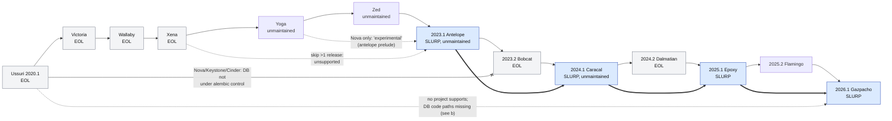
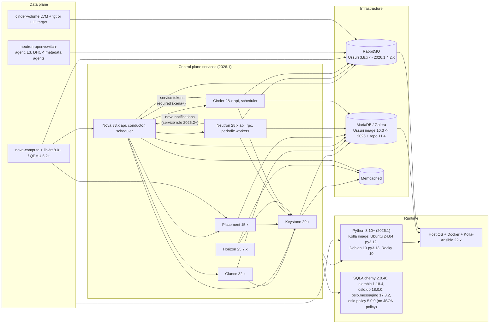

# Dependency graphs: Ussuri → 2026.1

| Field | Value |
|---|---|
| Author | Agent 2 — OpenStack Release Compatibility Expert (Stage 1, independent investigation) |
| Model | Opus (claude-opus-5-5) |
| Date | 2026-10-31 |
| Status | `DOCUMENTED-UNVERIFIED` — derived from upstream source trees; no graph edge was exercised in a lab. |
| Inputs read | Same as `compatibility-matrix.md` (upstream trees under `/home/user/src`, OzarLand skills `openstack-change-review` and `openstack-operational-decisions`). Evidence for every edge is cited in `compatibility-matrix.md` and `assessments/02-unsupported-transitions.md`. |

Legend used in all graphs:

- solid arrow `-->` : **Officially supported** transition (adjacent release, or consecutive SLURP from 2023.1).
- dashed arrow `-.->` : **Technically possible but unsupported**, or "experimental" by one project only.
- `--x` : **Incompatible** (the target code cannot handle the source state).

## (a) Release graph

`==>` marks the SLURP N→N+2 edges (officially supported). Sources: `releases@origin/master:data/series_status.yaml`,
`releases@origin/master:doc/source/index.rst` (SLURP section), Nova preludes per release.

Shortest **officially supported** deployed path: U → V → W → X → Y → Z → 2023.1 → 2024.1 → 2025.1 → 2026.1
(9 upgrades, 9 intermediate/target releases deployed). With Nova's experimental Yoga → 2023.1 edge it would be 8, but
that edge is not declared by the other services or by the release team and stays **Technically possible but
unsupported** for this journey.

## (b) Per-service "must pass through" points

These are the points where a later release's code cannot process state left by an earlier release unless some
intermediate release's code has run (code must *execute*; it need not be deployed to serve traffic). Each box names
the window of releases whose code can do the job.

```mermaid
flowchart TB
    subgraph NOVA["Nova (main + API DB)"]
        N0["Ussuri DB<br/>migrate main 407 / api 072"] --> N1{{"db sync with code from<br/>Xena | Yoga | Zed | 2023.1<br/>(legacy 402..422 / 067..087 then<br/>alembic stamp 8f2f1571d55b / d67eeaabee36)"}}
        N0 --x|"2023.2+ has no legacy repo"| NX["2023.2 .. 2026.1 db sync"]
        N1 --> N2["alembic chain to 2026.1 head<br/>(2026.1 code)"]
        N2 --> N3["online_data_migrations<br/>(all still in 2026.1 code)"]
        N3 --> N4{{"All non-deleted, non-forced-down<br/>nova-compute rows must report<br/>service version Epoxy (68) or newer<br/>before 2026.1 api/conductor/scheduler start"}}
    end

    subgraph KS["Keystone"]
        K0["Ussuri DB<br/>expand/contract/data 073..079"] --> K1{{"db_sync with code from<br/>Zed | 2023.1<br/>(legacy 073..079 then stamp 27e647c0fad4)"}}
        K0 --x|"2023.2+ alembic only"| KX["2023.2 .. 2026.1 db_sync"]
        K1 --> K2["alembic expand/contract to 2026.1"]
    end

    subgraph CIN["Cinder"]
        C0["Ussuri DB migrate 136"] --> C1{{"db sync with code from<br/>Xena | Yoga | Zed | 2023.1<br/>(legacy 135..145 then stamp 921e1a36b076)"}}
        C1 --> C2{{"online_data_migrations with code from<br/>Xena .. 2023.2<br/>(volume/snapshot use_quota)"}}
        C0 --x|"no legacy repo"| CX1["2023.2+ db sync"]
        C1 --x|"use_quota NULLs:<br/>9ab1b092a404 sets NOT NULL"| CX2["2024.1+ db sync"]
        C2 --> C3["alembic to 2026.1 head"]
        C3 --> C4["online_data_migrations (2026.1:<br/>remove_temporary_admin_metadata)"]
    end

    subgraph GL["Glance"]
        G0["Ussuri DB alembic ussuri_*01"] --> G1["2026.1 code: full alembic chain<br/>liberty .. 2024_1 still shipped"]
    end

    subgraph NE["Neutron (ML2/OVS)"]
        E0["Ussuri DB alembic ussuri heads"] --> E1["2026.1 code: all milestones<br/>LIBERTY .. 2025_2 kept"]
        E1 --> E2{{"neutron-status data checks must pass<br/>(segments uniqueness, port MAC, VLAN ids,<br/>HA networks, max 50 tags, RBAC target_project)"}}
        EL["Linux Bridge mech driver"] --x|"removed 2025.1"| E1
    end

    subgraph PL["Placement"]
        P0["Ussuri DB alembic"] --> P1["2026.1 code: chain intact<br/>(b4ed3a175331 .. a082b8bb98d0)"]
    end

    subgraph HZ["Horizon"]
        H0["no DB (sessions: unknown)"] --> H1["2026.1 code; settings rewrite<br/>(Django 2.2 -> 4.2, cache backend)"]
    end
```

The dashed/`x` edges are **Incompatible** at the code level; the remaining edges, where they skip releases, are
**Technically possible but unsupported** (see `assessments/02-unsupported-transitions.md`).

Per-service summary of the code that must run (minimal, not a recommendation):

| Service | Releases whose code must execute (minimum) | Why | Evidence |
|---|---|---|---|
| Nova | one of {Xena, Yoga, Zed, 2023.1} + 2026.1 | legacy→alembic conversion exists only in Xena–2023.1; INIT 401/066 ≤ Ussuri 407/072 | `nova@origin/unmaintained/2023.1:nova/db/migration.py`; commit `fd39e4b4be` |
| Keystone | one of {Zed, 2023.1} + 2026.1 | alembic stamping added in Zed, legacy removed in 2023.2; INIT 72 ≤ Ussuri 073–079 | `keystone@origin/unmaintained/zed:keystone/common/sql/upgrades.py`; commit `8c9462f6f` |
| Cinder | one of {Xena, Yoga, Zed, 2023.1} (db sync **and** online migrations) + 2026.1 | legacy conversion Xena–2023.1; `use_quota` online migration Xena–2023.2; 2024.1 makes it NOT NULL | `cinder@origin/unmaintained/2023.1:cinder/cmd/manage.py`; `cinder@origin/stable/2026.1:cinder/db/migrations/versions/9ab1b092a404_make_use_quota_non_nullable.py`; commit `e9dccb93b` |
| Glance | 2026.1 | alembic chain intact | `glance@origin/stable/2026.1:glance/db/sqlalchemy/alembic_migrations/versions/` |
| Neutron | 2026.1 | alembic chain intact | `neutron@origin/stable/2026.1:neutron/db/migration/__init__.py` |
| Placement | 2026.1 | alembic chain intact | `placement@origin/stable/2026.1:placement/db/sqlalchemy/alembic/versions/` |
| Horizon | 2026.1 | no DB | — |

Intersection: **2023.1** is the single release whose code satisfies the Nova, Keystone and Cinder windows at once
(Zed would too). It is also a SLURP release and the start of the officially supported SLURP chain. This is why 2023.1
appears as the natural "must execute" point for any shortened path.

## (c) Component dependency graph

Notes on (c):

- The RabbitMQ and MariaDB version labels come from Kolla package pins (`kolla@ussuri-eol:docker/rabbitmq/Dockerfile.j2`
  3.8.*, `kolla@origin/stable/2026.1:docker/rabbitmq/Dockerfile.j2` 4.2.*, `kolla@<ref>:kolla/template/repos.yaml`
  MariaDB 10.3 → 10.5 (Xena) → 10.6 (Zed, 2023.1) → 10.11 (2024.1–2025.1) → 11.4 (2025.2+)). RabbitMQ does not
  support jumping two major versions in one upgrade (`kolla-ansible@origin/stable/2026.1:doc/source/user/operating-kolla.rst`
  "SLURP extra preparations"); the infra path is outside this agent's scope [Not validated].
- Nova's dependency on Placement, Cinder (service token) and Neutron (service role for external events) are the
  cross-service RBAC edges that can break even when each service upgraded "correctly"
  (`cinder@xena-eol:releasenotes/notes/redirect-detach-nova-4b7b7902d7d182e0.yaml`,
  `nova@origin/stable/2025.2:releasenotes/notes/add-policy-service-role-eaa391e30431a9d6.yaml`).
- Old migration code (Xena–2023.1) depends on a *different* runtime: SQLAlchemy 1.4.x and sqlalchemy-migrate 0.13.0
  on Python 3.8–3.10. It cannot share the 2026.1 runtime box above.

## Open questions / what I could not verify

1. Whether the Nova N-2 tolerance (`OLDEST_SUPPORTED_SERVICE_VERSION`) can be exploited during a shortened path
   without a full compute stop — the code gate ignores `forced_down` rows, but forcing computes down with running
   instances is not a documented upgrade procedure.
2. RabbitMQ/MariaDB intermediate versions for Victoria–Yoga and the exact RabbitMQ hop sequence (Kolla/infra agent).
3. Whether Neutron agents older than N-1 can talk to a 2026.1 server even briefly; upstream does not promise it and no
   document was found that bounds agent skew beyond the normal N-1/SLURP rules.
4. Whether DB-backed Horizon sessions are in use (would add a Django migration dependency).
