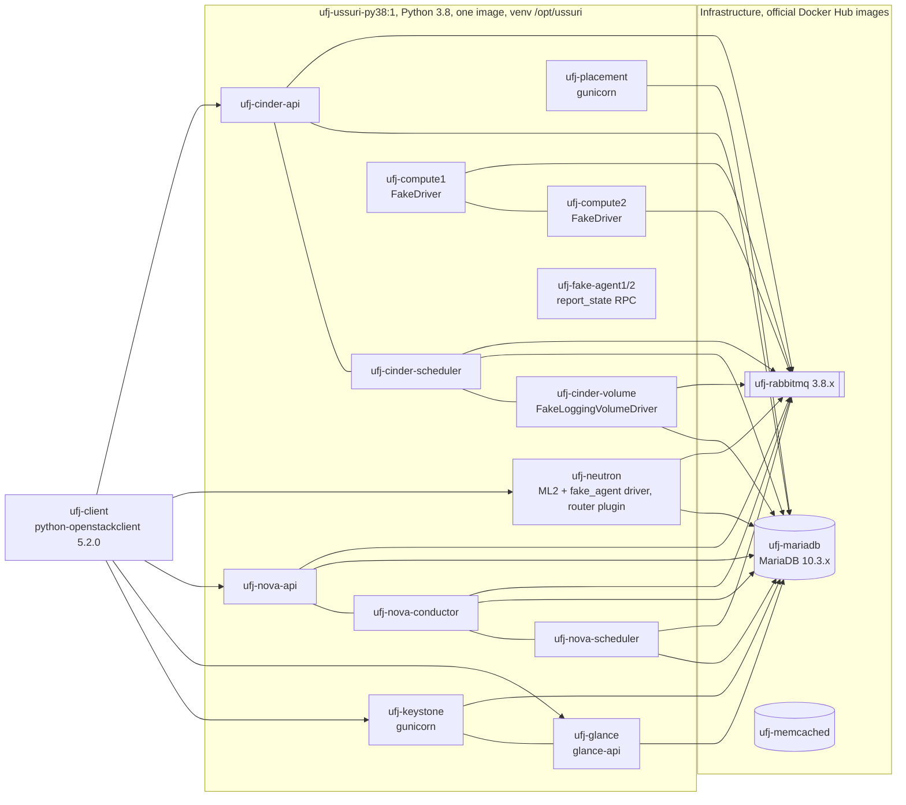

# Ussuri control-plane lab (container "baseline" for the Ussuri to 2026.1 journey)

A reproducible **OpenStack Ussuri control plane in Docker containers**, built from the upstream Ussuri code on PyPI under
the `ussuri-eol` upper constraints. It exists to create **real Ussuri database schemas and representative data through the
real APIs**, to freeze that state as a **baseline**, and to prove it can be **restored**. It is *not* a Kolla-Ansible
deployment and not a production-like topology (see "What it is not").

Status vocabulary of the journey: building and running this lab is `LAB-VALIDATED` only for what the evidence in
`journeys/ussuri-to-2026.1/evidence/lab-baseline/` shows. No migration experiment has been approved yet: **do not run any
later-release code against the baseline** (use a restored copy, never the preserved backup).

Everything the lab creates is named `ufj-*` (containers, volumes, network, images) so cleanup is targeted.

## Requirements

Docker (tested 29.9.2), bash, `bc`, `openssl`, outbound access to Docker Hub library images (`python`, `mariadb`,
`rabbitmq`, `memcached`) and to PyPI. 4 vCPU / 8 GB RAM / about 10 GB disk are enough. No KVM, no kernel modules: the
compute nodes use `nova.virt.fake.FakeDriver`. If your network uses a TLS-intercepting proxy, set `LAB_CA_BUNDLE=/path/ca.crt`
for the image build (the CA file is copied into the build context only for the build and removed afterwards).

## Quick start

```bash
./ufj.sh build          # ufj-ussuri-py38:1  (about 3-4 min; Docker Hub 429 rate limits are retried)
./ufj.sh up             # MariaDB 10.3, RabbitMQ 3.8, memcached, db syncs, all services (about 3 min)
./ufj.sh populate       # base resources (populate.sh) + baseline-coverage items (coverage.sh) + ODM runs, through the APIs (about 15 min)
./ufj.sh versions       # versions into the evidence directory
./ufj.sh capture        # DR-003 end state, two captures: A) computes+agents stopped, NOT forced down (backups/latest-pre-forced-down);
                        # then 'compute service set --down' through the API; B) final baseline (backups/latest). Each: API inventory,
                        # dumps, row counts, table checksums, T0 coverage counts, cold volume tarballs
./ufj.sh restore-test   # restore into FRESH MariaDB containers and prove equality (does not touch the live lab)
./ufj.sh verify         # compare the running control plane with the baseline inventory + functional checks
./ufj.sh all            # build, up, populate, versions, capture, restore-test, verify
./ufj.sh destroy --yes [--images]   # remove every ufj-* container/volume/network (never touches backups/ or .secrets/)
```

Restore the whole lab from a baseline (destroys the live lab state, needs `--yes`):

```bash
./ufj.sh restore --yes backups/baseline-<UTC time>   # volumes + config + secrets, starts without writing to the database
./ufj.sh verify backups/baseline-<UTC time>
```

Use the OpenStack client inside the lab:

```bash
docker exec -it ufj-client bash -c 'set -a; . /run/ufj/admin-openrc; set +a; export OS_PASSWORD=$(grep ^OS_PASSWORD /run/ufj/admin-openrc | cut -d= -f2); openstack server list --all-projects'
```

## Topology



## What it is not (differences from a Kolla-Ansible Ussuri deployment)

| Kolla-Ansible Ussuri | This lab |
|---|---|
| Kolla images (Ubuntu 18.04 or CentOS 8, Python 3.6) | one Python 3.8 image, services from PyPI wheels |
| Apache `mod_wsgi` for keystone/placement/horizon | gunicorn 20.0.4 |
| MariaDB 10.3 Galera (3 nodes) behind HAProxy/keepalived | one MariaDB 10.3 node, no Galera, no HAProxy |
| RabbitMQ cluster with `ha-all` policy | one RabbitMQ node, no HA policy |
| libvirt/KVM nova-compute, Open vSwitch or Linuxbridge, neutron agents (L3, DHCP, metadata) | `FakeDriver` computes, `fake_agent` test mechanism driver and fake L2 agents; **no L3/DHCP/metadata agents, no datapath** |
| LVM/Ceph/NFS cinder backend, cinder-backup | `FakeLoggingVolumeDriver` (test driver), no backup service |
| Horizon, Heat, Octavia, ... | not installed |
| `kolla-ansible deploy/upgrade`, `/etc/kolla`, kolla user IDs, Fernet in `/etc/keystone/fernet-keys` | none of it: plain containers, config rendered by `scripts/20-config.sh` |

The **database schemas, migrations and API-created rows are the real Ussuri ones**; the runtime around them is not. That
matters for what the baseline can prove: DB upgrade paths and API-visible state, not agents, data plane, or Kolla behaviour.

## Layout

| Path | Purpose |
|---|---|
| `image/` | `Dockerfile`, `requirements-lab.txt` (service versions), `upper-constraints-ussuri-eol.txt` (from `requirements@ussuri-eol`) |
| `scripts/` | numbered steps (`71` forced-down via API, `72` both captures) (`05` build, `10` infra, `20` config, `30/35` keystone, `40` db syncs, `50` services, `60` populate, `70` capture, `75` versions, `80` restore test, `85` restore into lab, `90` verify, `99` destroy), `lib.sh` |
| `scripts/inside/populate.sh`, `coverage.sh` | resource creation and the baseline-coverage checklist items, run inside `ufj-client`; every attempt is logged to `evidence/lab-baseline/coverage-actions.tsv` |
| `tools/coverage_counts.sh`, `tools/coverage_rest.py`, `tools/ufj_fake.py` | read-only T0 counts of the checklist items; REST-only items; fake compute driver with NUMA/PCPU |
| `tools/inventory.py` | JSON inventory + verify + functional checks (REST, keystoneauth) |
| `tools/fake_l2_agent.py` | fake agent (report_state + update_device_up) |
| `tools/tag_server.py` | server tags (python-openstackclient 5.2 has no option) |
| `wsgi/` | gunicorn entry points for keystone and placement |
| `kolla-probe/` | Track K probe: local `kolla-build` of `base` and `openstack-base` |
| `.secrets/`, `.run/`, `backups/` | **git-ignored**: generated passwords, rendered config, dumps and tarballs |

## Secrets and backups

Passwords are generated at run time (`openssl rand`) into `.secrets/passwords.env` (mode 600) and rendered into `.run/etc/`.
`backups/baseline-*/` contains database dumps (user password hashes, credential rows), the Fernet key volume, the rendered
config and the passwords: treat it as sensitive, keep it out of git (it is ignored) and off shared media. The evidence
copy under `journeys/ussuri-to-2026.1/evidence/lab-baseline/` holds only counts, checksums, the schema-only dump and the
API inventory (no passwords, no key material, no tokens).

## Idempotence and safety notes

* `10-infra`, `20-config`, `30`, `35`, `40`, `50` can be run again: existing containers/volumes are kept, `db sync` and
  `create_cell` are guarded. `60-populate` is "show or create" for most objects.
* `70-capture` **stops the service containers** (not MariaDB) for the duration of the dump and the cold volume copy so that
  the database is quiescent, then restarts them. Do not run it while someone else uses the lab.
* `85-restore-into-lab` and `99-destroy` delete the live lab state and need `--yes`. `80-restore-test` never touches it.
* Concurrency: there is no lock; run one script at a time.
* Fake compute: server state lives in the database and in the FakeDriver's memory. After a `nova-compute` restart the
  driver forgets its guests; the database still says ACTIVE (this is the baseline's truth).

## Fast-forward experiments (`ff/`, Stage 4)

One-shot images per release (`ff/build-release-image.sh <2023.1|2024.1|2025.1|2026.1>`, Python 3.10/3.11/3.12/3.12, PyPI under each
release's upper-constraints), MariaDB 10.3 -> 10.5 -> 10.6 -> 10.11 -> 11.4 (`ff/pull-images.sh` pulls via mirror.gcr.io when Docker Hub
answers 429). Everything runs on **restored copies** (never on `backups/`); all objects are named `ufj-ff-<run>-*`.

| Script | Purpose |
|---|---|
| `ff/05-baseline-checksum.sh before|after` | sha256 of every file of the preserved baselines |
| `ff/10-new-copy.sh <run> baseline|empty` | isolated copy (`BASE_BACKUP=` picks the baseline) or empty Ussuri schema (R0) |
| `ff/12-prechecks.sh <run>` | PC-* pre-checks (read-only) |
| `ff/20-engine.sh <run> mariadb:<ver>` | engine step: clean shutdown, new image on the datadir, `mariadb-upgrade`, `mariadb-check` |
| `ff/30-hop.sh <run> <rel> <n>` | the db syncs and ODMs of one hop (order of assessments/04 section 3) |
| `ff/40-checks.sh <run> <rel> <n>` | references `<db>_ref`, snapshots, comparisons A/B, versions, status tools |
| `ff/50-run-s2c.sh <run> baseline|empty [--observe]` | whole S2c run (strict by default: refuses to start on an uncommitted harness, `ff/00-version.sh`); hops H1, H1b (cinder 23.5.0, DR-004), H2, H3, H4, H4r; `H1B=0` skips H1b (dry-run proof of the PC-C1 gate) |
| `ff/00-version.sh <run> [--strict]` | harness commit, dirty flag, sha256 of every harness file and image id, into `<run>/harness.txt` |
| `ff/30-hop.sh` | per command: PC-E1 session `sql_mode` (`tools/session_sqlmode.py`), Nova ODM per cell |
| `ff/tools/compare.py` | comparator v2 = Amendment 1 of declared-differences.md section 8 (frozen artefact) |
| `ff/52-run-n1.sh` | EXP-DB-N1 (2026.1 code against the Ussuri database) |
| `ff/41-parity.sh`, `ff/46-targeted.sh`, `ff/47-engine-sqlmode.sh` | config parity, targeted value checks, sql_mode per engine |

`ufj.sh ff <script> [args]` runs one of them. Disposable runs are removed with `docker rm -f ufj-ff-<run>-db; docker volume rm ufj-ff-<run>-data`.
Baselines v2 (`backups-v2/`) and v3 (`backups-v3/`) are corrected derivatives of the preserved baseline, see EXP-DB-01.
